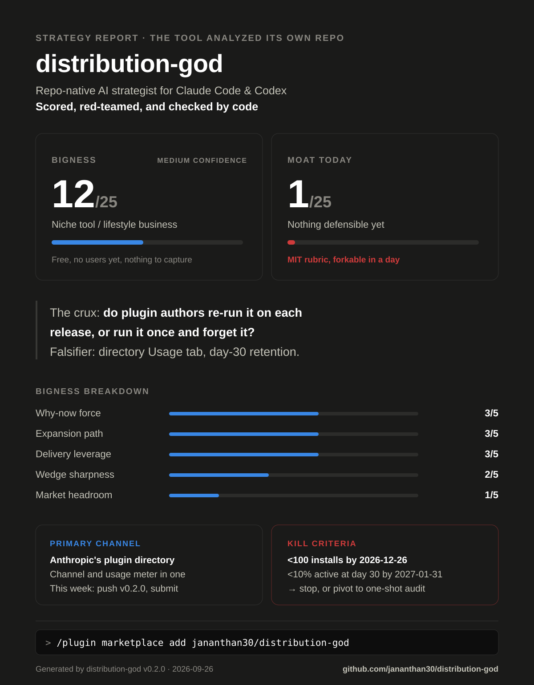

# Distribution God

**Point it at any repo. Get an investor-grade strategy report.**

[](https://github.com/jananthan30/distribution-god/actions/workflows/validate.yml)
[](LICENSE)
[](https://code.claude.com/docs/en/plugins)
[](https://developers.openai.com/codex)
[](https://agentskills.io)

**Claude Code**

```
/plugin marketplace add jananthan30/distribution-god
/plugin install distribution-god@distribution-god
```

**OpenAI Codex**

```
codex plugin marketplace add jananthan30/distribution-god
codex plugin add distribution-god@distribution-god
```

Then, in the repo you want analyzed, run `/distribution-god` (Codex:
`$distribution-god:distribution-god`, or just ask for a strategy report).

A repo-native AI strategist for Claude Code and OpenAI Codex. It reads your
codebase like a data room — license, dependencies, telemetry, onboarding,
release cadence are all strategy evidence — then researches your live market
and competitors on the web, and writes `STRATEGY.md`: positioning, a ranked
distribution plan, a prioritized gap table, a moat roadmap, and a calibrated
"how big can this get" verdict with explicit kill criteria. Then
`/close-gaps` turns the diagnosis into a prescription: it researches
current trends, papers, and products that fixed the same weakness, and keeps
only ideas you can test within a week.

Not another GTM prompt pack. Existing packs help revenue teams write emails.
This one starts from your code and tells you what business it can become —
then red-teams its own answer before showing you.

## It analyzed itself

The verdict on its own repo, unedited — from [STRATEGY.md](STRATEGY.md)
(v0.1.0 scored itself 17/25; the anchored v0.2.0 rubric and red team say 12):



<!-- verdict-table:start -->
| | |
|---|---|
| **Bigness** | **12/25 — Niche tool / lifestyle business** (confidence: Medium) |
| **Moat today** | **1/25 — Nothing defensible yet:** the rubric is MIT and forkable in a day; one point for anti-hype counter-positioning |
| **The crux** | Recurring use: do plugin authors re-run it on each release, or run it once and forget it? |
| **Falsifier** | List it in Anthropic's directory and read the **Usage** tab: share of installing accounts still active 30+ days after install (free, 60–90 days). Until the listing is live: weekly unique cloners from `gh api repos/jananthan30/distribution-god/traffic/clones`, logged to `metrics/traffic.csv` |
<!-- verdict-table:end -->

A strategy tool that flatters you is worthless. This one is built to say
"this is a feature, not a company" — even about itself.

**On other repos:** see [`examples/`](examples/) — full reports on public
projects, each stamped with the commit, date, model, and run mode.

## It prescribed for itself

`/close-gaps` run on that report, unedited — from [CLOSE-GAPS.md](CLOSE-GAPS.md)
(25 minutes, 80 web calls, parallel mode):

<!-- close-gaps:start -->
**Do this first**

**I1. A release-triggered workflow that re-runs the report and opens a Delta PR, offered after giving each author a free report** — closes `crux+bigness.wedge` — 13/20

1. After the `main` merge (see *Just do it*), write `examples/workflows/distribution-god-on-release.yml`: `anthropics/claude-code-action@v1` with `plugin_marketplaces`, `plugins: distribution-god@distribution-god` and the prompt `/distribution-god:distribution-god`, triggered by a release, a `v*` tag, a `.claude-plugin/plugin.json` change, or by hand.
2. Run it here by hand. Drop the idea if the PR's report has no Delta or `check_report.py` can't run inside the Action.
3. Give first: run the report on the report's First-10 plugins (STRATEGY.md §5) and open one issue each linking it.
4. In the same issue, ask whether they want it re-run on every release, naming the cost: the Claude GitHub App plus their own Claude token.
5. For every yes, open one PR with the report as `STRATEGY.md` plus the workflow, so its first run writes a Delta.

**Success:** ≥2 outside repos show a successful distribution-god workflow run in their public Actions tab by 2026-10-25. **Stop if:** 0 successful outside runs by 2026-10-25.

**Top ideas**

| # | Idea | Closes | Kind | First test | Build | Score |
|---|---|---|---|---|---|---|
| I1 | Release-triggered re-run workflow, offered after a free report | `crux+bigness.wedge` | proven | give 10 authors a report, then offer the workflow | S | 13/20 |
| I4 | Refundable $29 pre-order for a paid Launch Kit skill pack | `bigness.delivery` | proven | README Pricing section with a Polar/Gumroad checkout | S | 12/20 |
| I5 | Paid companion skill on the Agensi marketplace | `bigness.delivery` | fresh | list a $12 `launch-kit` skill, link it from the README | S | 12/20 |
| I6 | Link every report, card and badge back, and ask arrivals how they found it | `bigness.expansion` | proven | ship the links in the release I1 installs | S | 11/20 |
| I2 | No-model reminder Action for due kill criteria and new releases | `crux+bigness.wedge` | proven | offer it in I1's issues as the no-key option | S | 11/20 |
<!-- close-gaps:end -->

```
sensors (parallel)              strategist              check
┌─ repo-intel    ─┐
├─ market-scout  ─┼──►  synthesis in main loop  ──►  red-team  ──►  STRATEGY.md
└─ rival-scout   ─┘     (positioning, channels,                     + strategy card
                         gaps, moat, verdict)

then, on request — /close-gaps
STRATEGY.md ──► triage ──► gap-researcher × ≤3 ──► ranking ──► pragmatist ──► CLOSE-GAPS.md
                           (trends · papers · look-alikes)
```

## Use

| Command | What you get | Time |
|---|---|---|
| `/distribution-god` (Codex: `$distribution-god:distribution-god`) | Full run: market + rivals research, distribution plan, gaps, moat, verdict → `STRATEGY.md` + `assets/strategy-card.svg` | ~15–20 min (measured in sequential mode on four repos; parallel is faster) |
| `/close-gaps` (Codex: `$distribution-god:close-gaps`) | After a full run: researches trends, papers, and look-alike products for the report's weakest points → `CLOSE-GAPS.md`, at most five ideas, each with a linked precedent, a one-week test, and a stop signal | ~25 min (measured in parallel mode on this repo) |
| `/gap-scan` (Codex: `$distribution-god:gap-scan`) | Local-only audit of your distribution surface — prioritized gap table in chat | about a minute on a small repo, a few on a large one |

Also usable piecemeal in Claude Code: `@agent-distribution-god:rival-scout`
("who competes with X and how do they grow"), `@agent-distribution-god:red-team`
("attack this plan"), `@agent-distribution-god:repo-intel`,
`@agent-distribution-god:market-scout`, `@agent-distribution-god:gap-researcher`
("find proven ways to fix X"), `@agent-distribution-god:pragmatist` ("attack
these ideas") — or type `@` and pick the agent from the list.

### Before you run

- **Web permissions.** The full run makes roughly 20–30 web searches plus a
  similar number of page fetches; `/close-gaps` made 80 web calls
  on this repo (measured). For an unattended run, choose "don't ask
  again" on the first WebSearch/WebFetch prompt, or allow both in
  `~/.claude/settings.json`:
  `"permissions": {"allow": ["WebSearch", "WebFetch"]}`. Without web access
  it still runs and writes a local-only report, marked `NOT RESEARCHED`.
- **Codex:** start with live search — `codex --search`, or
  `web_search = "live"` in `~/.codex/config.toml`. The default cached search
  returns stale results.
- **Cost.** A full run uses up to four high-effort agents on your current
  model; expect it to cost more than a normal coding task. `/close-gaps`
  used about $10 of model usage on this repo (four high-effort agents, 80
  web calls; measured 2026-09-27). `/gap-scan` is cheap.
- **What it writes.** `STRATEGY.md` and `assets/strategy-card.svg` — plus
  `assets/strategy-card.png` only if you ask for it — and it never commits.
  Files it didn't create are never overwritten: next to your own
  `STRATEGY.md` it writes `STRATEGY.distribution-god.md`, and next to your
  own card `assets/strategy-card.distribution-god.svg`. Its own previous
  report and card are archived to `docs/strategy-history/`. `/close-gaps`
  writes only `CLOSE-GAPS.md` (or `CLOSE-GAPS.distribution-god.md` beside your
  own file) and archives its previous run the same way.
- **Privacy.** Search queries include a one-line description of your
  product (and, for `/close-gaps`, the weakness being researched). For a stealth project, use `/gap-scan`: it does no web research
  (at most it reads your repo's own GitHub metadata with `gh`).

### Update

Installs are pinned to the plugin version, so pull new releases explicitly:

```
claude plugin marketplace update distribution-god && claude plugin update distribution-god@distribution-god
codex plugin marketplace upgrade && codex plugin add distribution-god@distribution-god
```

### Install from a clone (Codex fallback)

```
git clone https://github.com/jananthan30/distribution-god ~/.distribution-god
~/.distribution-god/install-codex.sh
```

This links the skills into `~/.agents/skills`; Codex names linked skills
after the plugin, so invoke `$distribution-god:distribution-god` and
`$distribution-god:gap-scan`. `--copy` installs a frozen snapshot named
`$distribution-god` and `$gap-scan`; `--uninstall` removes them. It never
deletes a skill folder it didn't create — anything in the way is moved to
`~/.agents/skills-backup/`.

## What makes the output trustworthy

- **Calibrated verdicts.** Bigness /25 and Moat /25 scored against anchored
  rubrics — every sub-score cites its evidence in the report. Every market
  number is labeled `ESTIMATE` with the arithmetic shown; every verdict names
  its crux, its cheapest falsifier, and dated kill criteria. "This is a
  feature, not a company" is a permitted answer.
- **Distribution-first.** Every gap names the channel it blocks. Every channel
  names this week's concrete action. One primary channel — spreading across
  four is the failure mode the report is built to prevent.
- **2026-aware.** Scores AI-era channels most strategy content ignores:
  GEO (being the answer AI assistants cite), agent-installability
  (MCP servers, plugin/skill marketplaces, llms.txt), and post-outbound
  community dynamics.
- **Adversarial by design.** A red team re-derives every score from the
  rubric and recomputes the market math; each serious objection is applied
  or rebutted on the record in the Dissent section.
- **Checked before you see it.** `scripts/check_report.py` rejects a report
  with missing sections, unfilled blanks, scores that don't add up, unsourced
  rivals, or a broken card.

## Layout

```
skills/distribution-god/   orchestrator skill
  references/              moats · channel playbooks · AI-era channels ·
                           scoring rubrics · report template · strategy card
  references/sensors/      repo-intel · market-scout · rival-scout · red-team methods
  scripts/                 strategy_card.py (renders the card) · check_report.py
  assets/                  strategy-card template
skills/gap-scan/           fast local audit
skills/close-gaps/         research stage: triage → gap-researchers → pragmatist
  references/              idea rubric · CLOSE-GAPS.md template · sensor methods
  scripts/                 check_ideas.py (the CLOSE-GAPS.md contract)
agents/                    Claude Code subagents (thin wrappers over the sensor methods)
.claude-plugin/            plugin + marketplace manifests (Codex reads these too)
examples/                  reports on other public repos
evals/ · tests/            claude plugin eval suites · unit tests and fixtures
install-codex.sh           Codex fallback installer (~/.agents/skills)
docs/DESIGN.md             architecture & decisions
```

The skills follow the open [Agent Skills](https://agentskills.io) standard —
one methodology, both tools. With the plugin's agents available the sensors
run in parallel; otherwise the same sensor methods run as generic sub-agents
or in sequence.

## Contributing

`tests/run.sh` runs every check CI runs. Any change under `skills/` or
`agents/` needs a version bump — installs are pinned to the version string.
Change it in `.claude-plugin/plugin.json`; the unit tests then list every
other place it's pinned (`SKILL.md`, [CHANGELOG.md](CHANGELOG.md),
`llms.txt`, the scoring rubric, the card example) until they all agree. Ran it
on your repo and the verdict aged well (or badly)? Open a
[verdict check](https://github.com/jananthan30/distribution-god/issues/new?template=verdict-check.yml).

## License

MIT
