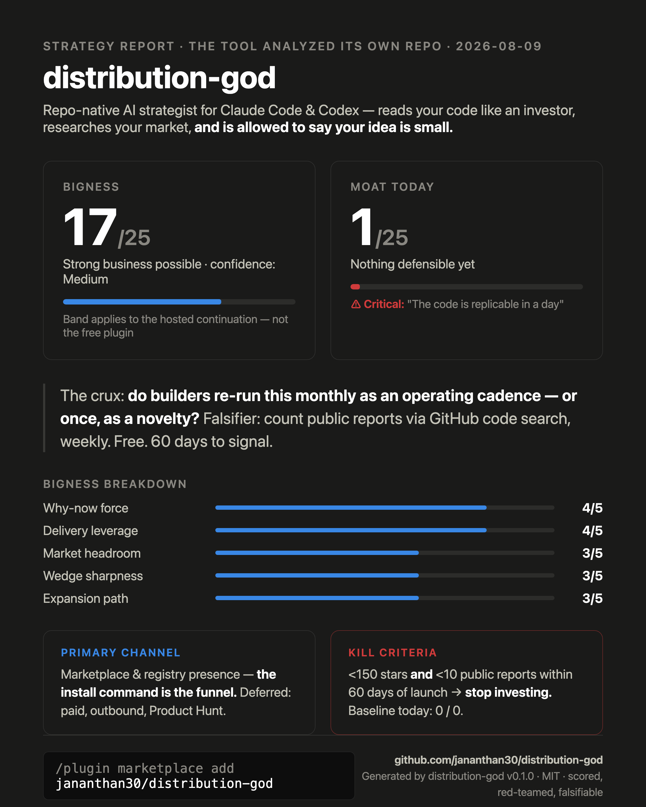

# Distribution God

**Point it at any repo. Get an investor-grade strategy report.**

[](LICENSE)
[](https://code.claude.com/docs/en/plugins)
[](https://agentskills.io)
[](https://agentskills.io)

A repo-native AI strategist for Claude Code and OpenAI Codex. It reads your
codebase like a data room — license, dependencies, telemetry, onboarding,
release cadence are all strategy evidence — then researches your live market
and competitors on the web, and writes `STRATEGY.md`: positioning, a ranked
distribution plan, a prioritized gap table, a moat roadmap, and a calibrated
"how big can this get" verdict with explicit kill criteria.

Not another GTM prompt pack. Existing packs help revenue teams write emails.
This one starts from your code and tells you what business it can become —
then red-teams its own answer before showing you.

## It analyzed itself

First thing it ever ran on: its own repo. The verdict, unedited — from
[STRATEGY.md](STRATEGY.md):



Every run generates one of these cards (`assets/strategy-card.svg`) alongside
the report — the shareable verdict for your README or launch post.

| | |
|---|---|
| **Bigness** | 17/25 — Strong business possible (confidence: Medium) |
| **Moat today** | **1/25 — nothing defensible yet.** One point for counter-positioning; every other power is 0 |
| **The crux** | Recurring use: do builders re-run this monthly, or once as a novelty? |
| **Falsifier** | GitHub code search for the report fingerprint, counted weekly. Free, 60 days to signal |

A strategy tool that flatters you is worthless. This one is built to say
"this is a feature, not a company" — even about itself.

```
sensors (parallel)              strategist              check
┌─ repo-intel    ─┐
├─ market-scout  ─┼──►  synthesis in main loop  ──►  red-team  ──►  STRATEGY.md
└─ rival-scout   ─┘     (positioning, channels,
                         gaps, moat, verdict)
```

## Install

**Claude Code** (plugin with parallel agents):

```
/plugin marketplace add jananthan30/distribution-god
/plugin install distribution-god@distribution-god
```

**OpenAI Codex** (Agent Skills standard, sequential mode):

```
./install-codex.sh
```

## Use

| Command | What you get | Time |
|---|---|---|
| `/distribution-god` (Codex: `$distribution-god`) | Full run: market + rivals research, distribution plan, gaps, moat, verdict → `STRATEGY.md` | 10–20 min parallel, 20–40 sequential |
| `/gap-scan` (Codex: `$gap-scan`) | Local-only audit of your distribution surface — prioritized gap table in chat | 3–5 min |

Also usable piecemeal in Claude Code: `@distribution-god:rival-scout` ("who
competes with X and how do they grow"), `@distribution-god:red-team` ("attack
this plan"), `@distribution-god:repo-intel`, `@distribution-god:market-scout`.

## What makes the output trustworthy

- **Calibrated verdicts.** Bigness /25 and Moat /25 scored against fixed
  rubrics; every market number labeled `ESTIMATE` with the arithmetic shown;
  every verdict names its crux, its cheapest falsifier, and dated kill
  criteria. "This is a feature, not a company" is a permitted answer.
- **Distribution-first.** Every gap names the channel it blocks. Every channel
  names this week's concrete action. One primary channel — spreading across
  four is the failure mode the report is built to prevent.
- **2026-aware.** Scores AI-era channels most strategy content ignores:
  GEO (being the answer AI assistants cite), agent-installability
  (MCP servers, plugin/skill marketplaces, llms.txt), and post-outbound
  community dynamics.
- **Adversarial by design.** A red-team pass attacks the wedge, the channel
  ranking, the moat loop, and the scores before anything ships; overruled
  objections appear in a Dissent section.

## Layout

```
skills/distribution-god/   orchestrator + reference library (the methodology)
  references/              moats · channel playbooks · AI-era channels ·
                           scoring rubrics · report template · strategy card
skills/gap-scan/           fast local audit
agents/                    repo-intel · market-scout · rival-scout · red-team
.claude-plugin/            plugin + marketplace manifests
install-codex.sh           Codex installer (~/.agents/skills)
docs/DESIGN.md             architecture & decisions
```

The skills follow the open [Agent Skills](https://agentskills.io) standard —
one methodology, both tools. Claude Code additionally gets the parallel
sensor/red-team agents; Codex runs the same phases sequentially.

## License

MIT
