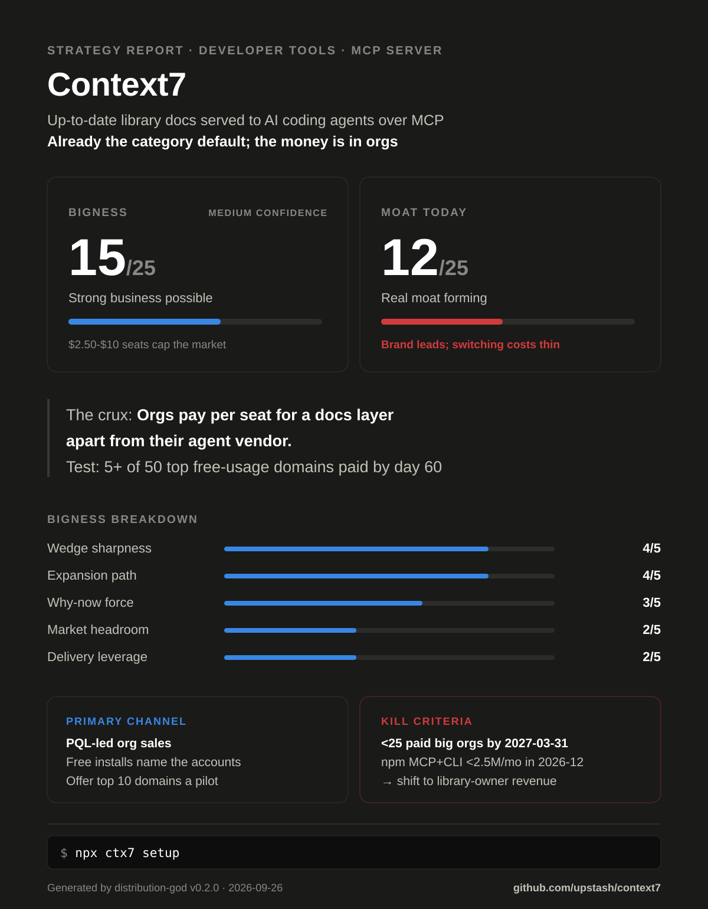

# Strategy Report — Context7

<!-- dg: {"v":"0.2.0","rubric":2,"date":"2026-09-26","mode":"sequential","web":true,"bigness":15,"subs":{"market":2,"why_now":3,"wedge":4,"expansion":4,"delivery":2},"confidence":"Medium","moat":12,"moat_rows":{"network":3,"switching":1,"scale_data":2,"brand":5,"cornered_counter":1}} -->

> Generated by distribution-god v0.2.0 on 2026-09-26 (sequential mode; web
> research on). Re-run after major changes; this report includes a delta
> section when a prior report exists.

> **Example run.** An automated analysis of [upstash/context7](https://github.com/upstash/context7) at commit `e275a84` (committed 2026-09-25), run 2026-09-26 by distribution-god v0.2.0 in sequential mode with web research, model claude-opus-5-5, ~14 min. Public information only; not affiliated with or endorsed by the project.

## Verdict

| | |
|---|---|
| **What this is** | A hosted docs-context service for AI coding agents (up-to-date, version-specific library docs), delivered through an open-source MCP server, `ctx7` CLI + skills, REST/Search API and SDKs |
| **Bigness** | 15/25 — Strong business possible (confidence: Medium) |
| **Moat today** | 12/25 — Real moat forming: the brand is the category default; everything else is thin |
| **The crux** | Organizations, starting with regulated ones, will pay per seat for a docs-context layer that sits apart from their agent vendor, and Context7 can sell it out of its free install base |
| **Falsifier** | Take the 50 company email domains with the most authenticated Context7 users over the last 90 days; offer each a 30-day Enterprise/on-prem pilot with private-repo import. Metric: paid conversions by day 60. 5+ of 50 means the crux holds; 2 or fewer means it's false. Cost: about one founder/AE-month plus pilot infra |

**Bigness breakdown**

| Dimension | Score | Evidence |
|---|---|---|
| Market headroom | 2/5 | SAM ESTIMATE $154M–$1.35B, geometric midpoint ~$457M → the $200–500M band (section 2) |
| Why-now force | 3/5 | One real, sourced shift: agents at work ([SO 2025](https://survey.stackoverflow.co/2025/ai): 30.9% use agents at work) on a standard plug ([MCP: 97M+ monthly SDK downloads, Dec 2025](https://www.anthropic.com/news/donating-the-model-context-protocol-and-establishing-of-the-agentic-ai-foundation)). These are two facets of one platform shift, so they count once |
| Wedge sharpness | 4/5 | Regulated or self-hosting orgs asked for this directly: [#59 self-host backend, 83 reactions](https://github.com/upstash/context7/issues/59), [#320 air-gapped docs, 30 reactions](https://github.com/upstash/context7/issues/320), [#34 private docs, 17](https://github.com/upstash/context7/issues/34). No paying-user or retention evidence found, so not 5 |
| Expansion path | 4/5 | free → Pro seat → teamspace → Enterprise/on-prem → Search API inside the org's own agents (`docs/howto/teamspace.mdx:23`, `docs/enterprise/on-premise.mdx:7`, `docs/search-api.mdx:96`). Each step reuses the client developers already run. Published seat-expansion data would earn 5 |
| Delivery leverage | 2/5 | It distributes itself (a listing in every agent marketplace), but serving costs real money per use: a hard free cap and metered overage (`docs/search-api.mdx:89-90`) and per-token private parsing (`$5 / 1M tokens`, [plans](https://context7.com/plans)). Weaker condition → anchor 2 |
| **Total** | **15/25** | |

Context7 has already won the free, individual-developer layer of "docs for
AI agents": rivals now market themselves as *alternatives to Context7*. The
business question is whether that install base turns into paid org seats
before agent vendors and docs hosts make a separate docs layer unnecessary.
At $2.50–$10 a seat, even a clean win is a strong business; getting to
venture scale needs a higher seat price or a second revenue line from
library owners (Docs7).

## 1. What the repo says (product intelligence)

- **Scope:** Monorepo of client packages for one hosted service. I analyzed the Context7 service and treated the packages as its surfaces (MCP server, `ctx7` CLI, TS SDK, AI SDK tools, pi and OpenCode extensions, agent plugins; `package.json:5-8`, `README.md:124-130`). The API backend, parser and crawler are private (`README.md:136`). Docs7, a docs-hosting product documented here (`docs/docs7/overview.mdx:1-20`) whose code ships separately as `@upstash/docs7` (`docs/docs7/cli.mdx:11`), is treated as expansion. This is an observer analysis of someone else's repo at commit `e275a84`; plans are phrased as what the Upstash maintainers would do.
- **Product:** It fetches current, version-specific docs and code snippets into an agent's context via the `resolve-library-id` / `query-docs` MCP tools or the `ctx7 library|docs` CLI commands (`README.md:99-113`). It has a remote endpoint `https://mcp.context7.com/mcp` and a stdio npm package (`server.json:17-48`), plus a one-request Search API (`docs/search-api.mdx:6-10`).
- **ICP & job-to-be-done:** A developer who writes code with Cursor, Claude Code, Codex or Copilot against fast-moving libraries, and whose agent hallucinates APIs or writes year-old patterns (`README.md:11-17`). Job: "make my agent write code against the version I actually use, without tab-switching." The paying ICP is the org behind that developer: private repos, Confluence and OpenAPI sources, SSO, on-prem (`docs/howto/private-sources.mdx:6`, `docs/enterprise.mdx:40-47`).
- **Stage:** Distributed. There are 990 commits since 2025-03-29 (`git log`), 38–40 a month in Aug–Sep 2026, and 110 in the last 90 days, 85% of the human ones by two maintainers (Fahreddin Özcan 59, Enes Gules 19; `git shortlog -sn --since=2026-06-27`). Releases run through changesets (`.changeset/config.json`, `package.json:23-24`); 39 tagged MCP releases, the latest `@upstash/context7-mcp@4.1.1` on 2026-09-14. CI runs tests on PRs (`.github/workflows/test.yml:3-14`). 142 author names across history.
- **Strategy signals in code:**
  - MIT license on the clients only (`LICENSE:1-3`). Anyone can fork the client, but nobody can fork the index. The open part is distribution; the closed part is the product.
  - It is fully PLG-ready. OAuth signup inside `npx ctx7 setup` (`README.md:51-55`). Anonymous MCP users get a sign-in prompt (`packages/mcp/src/lib/auth/auth-prompt.ts:31-38`). Free/Pro/Enterprise tiers with per-seat billing (`docs/search-api.mdx:89-90`), teamspaces (`docs/howto/teamspace.mdx:65-67`), and SSO, SOC 2 infrastructure and on-prem (`docs/enterprise.mdx:40-50`, `docs/enterprise/on-premise.mdx:7-18`, first added 2026-03-03).
  - Telemetry: the CLI posts setup/install/command events, with opt-out via `CTX7_TELEMETRY_DISABLED` (`packages/cli/src/utils/tracking.ts:3-9`, `packages/cli/src/commands/setup.ts:516-517`). The MCP server exports OpenTelemetry/Prometheus ops metrics (`packages/mcp/src/lib/telemetry-config.ts:1-14`). These are operational metrics, not account analytics; any company-level view lives in the private backend.
  - Platform surface: the Search and Context REST APIs, a TS SDK and Vercel AI SDK tools (`docs/search-api.mdx:94-98`), and Vercel Marketplace auth (`packages/mcp/src/lib/vercelMarketplaceJwt.ts:3`).
  - Switching-cost levers: owner-side `context7.json` with agent `rules` (`docs/library-owners.mdx:44,72`), library claiming with usage analytics (`docs/howto/claiming-libraries.mdx:13-18`), and private sources per teamspace.
  - Quality system: benchmark-driven retrieval and trust scores per library (`docs/enterprise.mdx:70-72`). Prompt-injection classifier (`docs/security/data-safety.mdx:6-17`).
  - Ecosystem ridden: MCP (`@modelcontextprotocol/server` dependency in `packages/mcp/package.json`) and every major coding agent (`packages/cli/src/setup/agents.ts:125-249`).
- **Distribution surface today:** Present: npm with five packages (`@upstash/context7-mcp` at 3,279,367 downloads over 2026-08-26 to 2026-09-24, [npm API](https://api.npmjs.org/downloads/point/last-month/@upstash/context7-mcp)); the official MCP Registry (`server.json`, `.github/workflows/mcp-registry.yml:67-70`); the [Docker MCP Catalog](https://hub.docker.com/mcp/server/context7/overview); Smithery (`packages/mcp/smithery.yaml`); a Cursor one-click deeplink (`README.md:3`); Claude Code, Codex, Copilot and Cursor plugins (`.claude-plugin/marketplace.json`, `plugins/`); a Gemini extension (`gemini-extension.json`); a Kiro power (`plugins/context7-power/POWER.md`); `llms.txt` live at context7.com; 15 translated READMEs (`i18n/`); 62,429 stars and topics `llm, mcp, mcp-server, vibe-coding` (GitHub API, 2026-09-26). Absent: an official Docker image ([#214 still open](https://github.com/upstash/context7/issues/214)), any Enterprise, SSO or on-prem mention in the README (`README.md:1-159`), and comparison pages against rivals.

## 2. Market

- **Category:** Documentation context for AI coding agents. Buyers and rivals mostly name it after the leader: "Context7 alternatives" ([Neuledge](https://neuledge.com/blog/2026-02-06/top-7-mcp-alternatives-for-context7-in-2026/), [mcp.directory](https://mcp.directory/collections/top-alternatives-to-context7-mcp)). Nia calls it "context augmentation" ([YC](https://www.ycombinator.com/companies/nozomio)). Context7's enterprise pitch drifts toward "LLM-ready internal context" (`docs/enterprise.mdx:3-8`), where it meets code-search and knowledge tools.
- **Size:** ESTIMATE $154M–$1.35B SAM (geometric midpoint $457M)
  - Bottom-up: 36.5M professional developers ([SlashData, early 2025](https://www.slashdata.co/post/global-developer-population-trends-2025-how-many-developers-are-there)) × 14.1%–30.9% who use AI agents at work, from daily to any frequency ([SO 2025](https://survey.stackoverflow.co/2025/ai)) × $30–$120/yr per seat, from the large-org Enterprise floor of $2.50/user/month to Pro at $10/seat/month ([plans](https://context7.com/plans)) = $154M–$1.35B.
  - Why these buyers need the paid layer: the Free plan stops at 1,000 calls a month, about 33 a day (`docs/search-api.mdx:89`). Private repos and teamspaces are paid-only (`docs/howto/private-sources.mdx:38`). This is an assumption, not a conversion forecast. The survey shares come from SO respondents applied to SlashData's professional count. Small-team Enterprise seats at $30/user/month were left out as a minority of seats; including them would raise the high end.
  - Top-down: none found. The session's web-search budget ran out after 9 searches, and no analyst figure for this narrow category was verified. The bottom-up figure stands alone, hence Medium confidence.
- **Why now:**
  - Agents moved into daily work: 84% use or plan to use AI tools, 51% of professionals use them daily, and 30.9% use agents at work ([SO 2025](https://survey.stackoverflow.co/2025/ai)). Stale training data turns into hallucinated APIs at the moment of code generation, which is the exact failure Context7 sells against (`README.md:11-17`).
  - MCP became the standard plug for those agents: 10,000+ active public servers, 97M+ monthly SDK downloads, built into ChatGPT, Cursor, Gemini, Copilot and VS Code ([Anthropic, 2025-12-09](https://www.anthropic.com/news/donating-the-model-context-protocol-and-establishing-of-the-agentic-ai-foundation)). This is the same shift, so it doesn't count as a second, independent force.
- **Timing risk:** Docs hosts now ship the substitute themselves: Mintlify "generates a search MCP server for your site and hosts it at the `/mcp` path" ([Mintlify docs](https://www.mintlify.com/docs/ai/model-context-protocol)). Agents ship built-in web fetch and search ([Claude Code tools](https://code.claude.com/docs/en/tools-reference)). A central registry feeding agents is an attack surface ([ContextCrush, Noma, 2026-03-05](https://noma.security/blog/contextcrush-context7-the-mcp-server-vulnerability)). The January 2026 free-tier cut (~6,000 → 1,000 requests/month, [Neuledge](https://neuledge.com/blog/2026-02-06/top-7-mcp-alternatives-for-context7-in-2026/)) seeded the alternatives market. Stdio-package npm downloads peaked at 4.57M in 2026-04 and are pacing ~3.2M in 2026-09 ([npm range API](https://api.npmjs.org/downloads/range/2025-09-25:2026-09-24/@upstash/context7-mcp)). That may be migration to the remote endpoint, which npm can't see.
- **Watering holes:** For individual developers: r/cursor, r/ClaudeAI, r/mcp, r/ChatGPTCoding and forum.cursor.com (member counts unverified); the AI-coding YouTube creators already covering Context7 (Better Stack, Cole Medin, AICodeKing; `README.md:146-155`); the Upstash Discord (`README.md:144`); MCP directories (official MCP Registry, [Docker MCP Catalog](https://hub.docker.com/mcp/server/context7/overview), Smithery, [mcp.directory](https://mcp.directory/collections/top-alternatives-to-context7-mcp)). For the wedge buyer, it's the org's own developers: the domains already signing in. Queries: "context7 alternative", "best MCP servers for coding", "context7 on-premise", "MCP server for internal documentation", "context7 vs deepwiki".

## 3. Competitive field

| Rival | Positioning | Price | Primary channel | Their moat | Their weakness | Source |
|---|---|---|---|---|---|---|
| Nia (Nozomio) | "Context-augmentation layer for agents": indexes docs and codebases | $14.99/mo per Neuledge; own pricing page unverified (HTTP 429) | YC launch + founder-led X; $6M seed ([YC](https://www.ycombinator.com/companies/nozomio)) | None visible | Team of 3 (YC); public repo last pushed 2026-04-06, 74 stars (GitHub API) | [YC](https://www.ycombinator.com/companies/nozomio), [repo](https://github.com/nozomio-labs/nia) |
| DeepWiki MCP (Cognition) | Free remote MCP over any public GitHub repo's generated wiki | Free, no auth; private repos need a Devin account | Bundled with Devin and deepwiki.com pages | Cognition/Devin distribution | Public repos only; architecture-level, not version-specific API docs | [Devin docs](https://docs.devin.ai/work-with-devin/deepwiki-mcp) |
| GitMCP | "Instantly create a Remote MCP server for any GitHub repository" | Free (no pricing on site) | GitHub / OSS word of mouth | None | 8,425 stars, last push 2026-05-08 (GitHub API): momentum slowing | [gitmcp.io](https://gitmcp.io/), [repo](https://github.com/idosal/git-mcp) |
| Grounded Docs MCP Server | "Open-Source Alternative to Context7, Nia, and Ref.Tools" | Free, self-hosted | GitHub + "alternative to" search | None | You run and feed the index yourself; 1,760 stars | [repo](https://github.com/arabold/docs-mcp-server) |
| Context (Neuledge) | "Local-first documentation for AI agents" (SQLite/FTS5, offline) | Free, Apache 2.0 | Content: "Top 7 alternatives to Context7" | Privacy / offline | 412 stars; user builds each doc package | [repo](https://github.com/neuledge/context), [blog](https://neuledge.com/blog/2026-02-06/top-7-mcp-alternatives-for-context7-in-2026/) |
| Ref (ref.tools) | "Helping coding agents never make mistakes working with public or private libraries" | unverified (pricing page showed no plans, 2026-09-26) | MCP directories | None visible | ref.tools homepage now pitches a different product ("review the plan before the diff"); MCP repo still pushed 2026-09-14 | [repo](https://github.com/ref-tools/ref-tools-mcp) |
| Mintlify `/mcp` (partner-competitor) | Auto-generated search MCP server for every Mintlify docs site | Starter $0 incl. MCP; Pro $450/mo ([pricing](https://www.mintlify.com/pricing)) | Its docs-platform customers ("a quarter of the last YC batch") | First-party docs for thousands of vendors | One MCP per vendor; no cross-library search; the direct target of Docs7's `mint.json` import | [Mintlify docs](https://www.mintlify.com/docs/ai/model-context-protocol) |

**Indirect:** The agent's built-in web fetch/search ([Claude Code tools](https://code.claude.com/docs/en/tools-reference)) wins by default because it is already on, with zero install. The largest group does nothing: 37.9% of developers don't plan to use agents at all ([SO 2025](https://survey.stackoverflow.co/2025/ai)), and many rely on training data plus pasted docs. Vendor `llms.txt` files and per-vendor MCP servers are first-party and free. In-house RAG over internal docs is what platform teams build when security review blocks SaaS. Cursor's former `@Docs` page URL now redirects to its prompting guide (checked 2026-09-26), a sign IDE vendors aren't prioritizing a first-party docs index.

**Cautionary tale:** Docfork ("Up-to-date docs for AI Coding Agents", MIT, free tier of 1,000 requests/month per [Neuledge](https://neuledge.com/blog/2026-02-06/top-7-mcp-alternatives-for-context7-in-2026/)). Its GitHub repo is archived (last push 2026-06-13, GitHub API), and docfork.com now redirects to the founder's personal site. The lesson: copying the leader's public index at the leader's price doesn't survive. The index needs a paid layer or a platform behind it.

**White space:** "Public and private docs in one agent endpoint, deployable on-prem, from the tool your developers already run." DeepWiki is public-only unless you buy Devin. Mintlify is one vendor per server. Nia is a three-person team. The OSS self-host tools have no index. Context7 is the only one with the public index, org features (`docs/howto/private-sources.mdx:6`) and an on-prem stack (`docs/enterprise/on-premise.mdx:7-18`) behind the same MCP URL.

## 4. Strategy

- **Positioning:** For platform and security teams at regulated engineering orgs rolling out coding agents, Context7 is the only docs-context layer their developers already run that serves public *and* private library docs through one MCP endpoint, including on-prem, because the free MCP server/CLI and the Enterprise product are the same client (`server.json:36-48`, `docs/enterprise/on-premise.mdx:11-16`).
- **Wedge:** Regulated or security-reviewed orgs (finance, health, government contractors) with 200+ engineers who already use Claude Code, Cursor or Copilot and can't send code queries to a third-party SaaS, or need internal SDK docs next to public ones. The on-prem trial exists (`docs/enterprise/on-premise.mdx:26-30`), and the demand is on record (#59, #320). **6-month win condition:** 25 paying orgs of 200+ seats, 10 of them on-prem, by 2027-03-31.
- **Expansion:** Regulated orgs first. That yields reference logos plus a security pack that shortens the next review. Next come unregulated enterprises on the SaaS Enterprise tier with the same pitch and no infra work. Then platform: the Search API inside the org's own internal agents (`docs/search-api.mdx:96`). Finally the supply side: those orgs' public SDK docs on Docs7, which is a separate revenue line.

## 5. Distribution plan

**Channel ranking** (rubric /20):

| Channel | Reach | Econ | Repo evidence | Founder fit | Total | Call |
|---|---|---|---|---|---|---|
| Registries & agent marketplaces (npm, MCP Registry, Docker catalog, Smithery, Claude/Codex/Cursor/Copilot plugins, Gemini, Kiro) | 2 | 5 | 5 | 5 | 17/20 | claimed |
| PQL-led org sales: free-usage company domains → champion → on-prem/SSO pilot | 4 | 4 | 4 | 4 | 16/20 | PRIMARY |
| Champion-arming docs + GEO (security pack, on-prem, honest comparison pages) | 3 | 5 | 4 | 4 | 16/20 | secondary |
| Library-owner supply side (claiming, verification, Docs7 attribution) | 3 | 4 | 3 | 4 | 14/20 | defer |
| Creator videos + launch events (YouTube, Show HN) | 2 | 4 | 3 | 3 | 12/20 | defer |
| Paid ads / cold outbound to individual developers | 2 | 1 | 1 | 3 | 7/20 | defer |

PQL (product-qualified lead) sales and champion-arming docs tie at 16. PQL goes first because its results test the crux directly: do orgs pay? Registries score highest but are already won; they only need maintenance. Human sales is only for domains with 200+ active developers; smaller teams go to self-serve Pro. At $2.50–$10 a seat, anything smaller can't pay for a salesperson.

**Founder-fit basis:** Inferred from public evidence. The maintainers are Upstash staff (`git shortlog`); the founder announces pricing publicly on X ([post](https://x.com/enesakar/status/2011896241047978236)). Context7 already sells SSO, SOC 2-backed and on-prem Enterprise plans (`docs/enterprise.mdx:40-50`), so there is an enterprise motion to extend. There's no evidence of a large sales team, hence 4, not 5.

**Deferred channels:**
- Library-owner supply side / Docs7: it's the best long-term loop, but running it now splits a small team before the org-revenue crux is answered.
- Creators and launches: they reach individual developers, who are already won. They don't reach the wedge buyer.
- Paid and cold outbound to individuals: Pro at $120/yr can't carry paid customer acquisition cost.

**Sequence** (units = paying org teamspaces):
- **First 10:** Founder-led. Email the most active users at the 10 domains with the most authenticated developers and offer a 30-day on-prem or private-repo pilot. Comment on the closed #59 and #320 threads (113 reactions between them) announcing the on-prem trial.
- **First 100:** Ignition: an "On-prem GA + security pack" post on the Upstash blog and Show HN. Concierge private-source import for every pilot (Confluence, OpenAPI, Git; `docs/howto/private-sources.mdx:6`).
- **First 1,000:** A weekly PQL batch of 25 domains, a self-serve Enterprise trial for 50–200-developer orgs, and seat expansion tracked per teamspace.

**90-day plan:**
- Week 1: Build the domain rollup and pick 10 domains; the founder sends pilot offers → PQL → pilots booked.
- Week 2–4: Add a "For teams: private repos, SSO, on-prem" block to the README and the MCP sign-in prompt → PQL → enterprise-page visits. Publish a security pack (ContextCrush postmortem, injection defenses, Upstash Trust Center) → PQL → security-review days. Publish an honest comparison page (vs DeepWiki MCP, Mintlify `/mcp`, Nia) → secondary → citation share on "context7 alternative".
- Month 2: Offer pilots to the next 50 domains with 200+ developers; convert week-1 pilots; publish one on-prem case study with permission → PQL → paid orgs.
- Month 3: Run the weekly PQL batch and the self-serve Enterprise trial; measure private sources per paying org → PQL → seats and net expansion.
- **Week-12 checkpoint:** 5+ paid of the first 50 pilots, 3+ private sources per pilot, and at least 1 live on-prem deploy → double down. 2 or fewer paid → the crux is false; shift effort to library-owner revenue (Docs7, owner analytics).

## 6. Gaps

| Gap | Severity | Blocks channel | Fix | Effort |
|---|---|---|---|---|
| No company-level view of free usage in the open clients: CLI events carry agents/scope/mode only (`packages/cli/src/commands/setup.ts:516`), and the backend is private (`README.md:136`), so whether a domain rollup exists is unverified | P0 | PQL org sales | A weekly rollup: authenticated users + calls per company email domain; flag domains with 20+ developers | S |
| The sign-in prompt sells only "free higher rate limits" (`packages/mcp/src/lib/auth/auth-prompt.ts:32`); the API key is optional (`server.json:30,44`), so anonymous org usage is invisible | P1 | PQL org sales | Add a team line to the prompt and the `ctx7 setup` success screen, and ask for the company at OAuth | S |
| The README (the 62k-star landing page) never mentions Enterprise, SSO, private repos or on-prem (`README.md:1-159`) | P1 | Champion-arming docs | A four-line "For teams" block under Installation, linking the security pack and on-prem trial | S |
| No comparison pages; rivals own the "Context7 alternatives" query ([Neuledge](https://neuledge.com/blog/2026-02-06/top-7-mcp-alternatives-for-context7-in-2026/)) | P1 | Champion-arming docs / GEO | Honest comparison plus public benchmark method (`docs/enterprise.mdx:70`) | M |
| No public ContextCrush postmortem or third-party test result linked from security docs (`docs/security/data-safety.mdx:6-17`) | P1 | PQL (security review) | Postmortem + yearly pen-test summary on the Trust Center | M |
| No public usage metric beyond "100,000+ active users" (`docs/docs7/overview.mdx:20`, undated); npm can't see remote-MCP growth | P2 | Measurement | Publish dated monthly active users and calls | S |
| Official Docker image still missing ([#214](https://github.com/upstash/context7/issues/214)) though a Dockerfile exists (`packages/mcp/Dockerfile:1-3`) | P2 | Registries | Publish to GHCR/Docker Hub from the release workflow | S |

## 7. Moat roadmap

**Moat today**

| Row | Score | Evidence |
|---|---|---|
| Network economies | 3/5 | Any user can add a public library that then serves everyone (`docs/adding-libraries.mdx:12-16`); owners claim and tune theirs (`docs/howto/claiming-libraries.mdx:13-18`); GitHub code search counts 2,712 `context7.json` files (lower bound, 2026-09-26) |
| Switching costs | 1/5 | An individual leaves by swapping one MCP URL; teams lose teamspace, rules and private-source config (`docs/howto/private-sources.mdx:6`), which is hours of work, not days |
| Scale economies / data | 2/5 | Clearly beyond "collected but unused": benchmark scores and trust scores rank retrieval (`docs/enterprise.mdx:70-72`). Misses "usage data demonstrably improves quality": no such evidence published |
| Brand / category ownership | 5/5 | The category is named after it: rivals position as its alternative ([Grounded Docs](https://github.com/arabold/docs-mcp-server), [Neuledge](https://neuledge.com/blog/2026-02-06/top-7-mcp-alternatives-for-context7-in-2026/)); 62,429 stars vs 8,425 for the next docs-MCP rival (GitHub API) |
| Cornered resource / counter-positioning | 1/5 | Soft exclusive only: the `context7.json` convention and claimed/verified libraries. Owners can publish to Mintlify `/mcp` or DeepWiki too |
| **Total** | **12/25** | Real moat forming |

- **Buildable powers:** (1) *Network economies on the supply side.* Every owner who claims, configures and verifies a library improves answers for all its users, and owner analytics plus Docs7 give owners a reason to keep tuning. (2) *Switching costs in orgs.* Private sources, rules and on-prem indexes build up per org, and once an org's internal SDKs are indexed and benchmarked, leaving takes days of re-ingestion.
- **Compounding loop:** `more agent users → more library owners claim and tune their docs on Context7 → higher benchmark scores and fresher answers → more agent users (and a bigger PQL pool that funds the index) → more owners`
- **First signal:** The share of query volume served from claimed/verified libraries, and the median benchmark score of claimed vs unclaimed libraries. Check monthly from 2026-10. On the org side: private sources per paying teamspace at day 60.
- **Incumbent response:** Mintlify's best move is one cross-site "all Mintlify docs" MCP. That undercuts the public index with first-party docs. The loop survives only if owner config lives on Context7 (claiming, rules) and Docs7 keeps pulling Mintlify sites over via `mint.json` import (`docs/docs7/quickstart.mdx:10-12`). If Anthropic, OpenAI or GitHub bundle a first-party docs index as the agent default, the public loop likely doesn't survive, and the org wedge (on-prem, private docs) becomes the business.

## 8. What would have to be true (top-band outcome)

1. At least 60% of professional developers use agents at work in the Stack Overflow 2028 survey (30.9% in 2025).
2. Average realized org seat price holds at $10+/user/month (the list range runs from $2.50 to $30).
3. Agent vendors keep docs retrieval external via MCP rather than bundling a default first-party index. This shows up as Context7 staying in their recommended MCP lists through 2027.
4. Library owners pay for the agent-facing channel: 1,000+ Docs7 Pro sites at $200/month, a second revenue line.
5. No repeat ContextCrush-class incident; claimed/verified libraries serve the majority of query volume.

## 9. Kill criteria

- If fewer than 25 orgs of 200+ seats are paying by 2027-03-31, stop leading with org sales and put the effort into library-owner revenue (Docs7, owner analytics).
- If combined `@upstash/context7-mcp` + `ctx7` npm downloads fall below 2.5M/month for 2026-12 and authenticated remote-MCP calls (dashboard) are also flat or falling, treat it as bundling displacement and pivot to on-prem-only plus the Search API.
- If the first 50-domain pilot cohort (starting 2026-10-05) converts 2 or fewer by day 60, the crux is false; re-price or re-target before scaling PQL.

## 10. Next 5 actions (this week)

1. The maintainers build the domain rollup (authenticated users + calls per company email domain, last 90 days) and list domains with 20+ developers. Serves PQL org sales; moves qualified accounts.
2. The founder emails the most active users at the top 10 domains a 30-day on-prem/private-repo pilot offer and comments the trial on #59 and #320. Serves PQL; moves pilots booked.
3. Add a "For teams: private repos, SSO, on-prem trial" block to the README and one line to the MCP sign-in prompt (`auth-prompt.ts:32`). Serves PQL and champion arming; moves enterprise-page visits from README.
4. Publish an honest "Context7 vs DeepWiki MCP vs Mintlify `/mcp` vs Nia" page on context7.com/docs. Serves the secondary (GEO); moves citation share on "context7 alternative".
5. Publish the ContextCrush postmortem and current injection defenses, linked from the security overview. Serves PQL (security review); moves security-review cycle time.

## Dissent

**Red-team adjustments:** no score changes (Bigness 15→15, Moat 12→12).

- *Serious: the moat loop runs on the free public index while the paid wedge feeds nothing back.* Applied: added switching costs in orgs as the second buildable power and stated the funding link in the loop (section 7).
- *Serious: "enterprises rolling out agents" is too broad and contested (Cognition, Sourcegraph, GitHub).* Applied: narrowed the wedge to regulated or security-reviewed orgs with 200+ engineers, where #320 and #59 show demand and on-prem already exists (section 4).
- *Serious: incumbent move. Mintlify aggregates its per-site MCPs, or Cognition ships private DeepWiki.* Partly rebutted: Context7 indexes GitHub repos regardless of docs host, and Docs7 imports `mint.json`. Applied: named it in Incumbent response and added a bundling-displacement kill criterion (section 9).
- *Serious: a weaker hidden assumption. The public-index advantage doesn't carry over to private docs.* Rebutted: the positioning rests on what does carry over (already installed, one endpoint for public and private), and the pilot falsifier tests exactly that.
- *Minor: PQL economics fail for teams under 50 seats at $2.50–$10.* Applied: human sales only for 200+-developer domains (section 5).
- *Minor: the SAM price range leaves out $30/user/month small-team Enterprise seats.* Rebutted: the range is seat-weighted toward large orgs. Using $360 would move Market headroom to 3 (midpoint ~$792M), but Bigness would stay in the same band.
- *Minor: Delivery leverage may be under-scored, since the founder's post says LLM costs came in lower than expected.* Rebutted: I couldn't fetch that post myself (HTTP 402), metering and per-token parsing are documented, and a tie goes to the lower anchor.

## Sources

- **Market:** [Stack Overflow 2025 survey, AI](https://survey.stackoverflow.co/2025/ai) · [SlashData developer population](https://www.slashdata.co/post/global-developer-population-trends-2025-how-many-developers-are-there) · [Context7 plans](https://context7.com/plans) · [Docs7 pricing](https://context7.com/docs7/overview) · [npm downloads API](https://api.npmjs.org/downloads/point/last-month/@upstash/context7-mcp) · [npm range API](https://api.npmjs.org/downloads/range/2025-09-25:2026-09-24/@upstash/context7-mcp)
- **Rivals:** [Neuledge: top 7 alternatives](https://neuledge.com/blog/2026-02-06/top-7-mcp-alternatives-for-context7-in-2026/) · [Nozomio on YC](https://www.ycombinator.com/companies/nozomio) · [DeepWiki MCP](https://docs.devin.ai/work-with-devin/deepwiki-mcp) · [GitMCP](https://gitmcp.io/) · [Grounded Docs MCP](https://github.com/arabold/docs-mcp-server) · [Neuledge Context](https://github.com/neuledge/context) · [Ref MCP](https://github.com/ref-tools/ref-tools-mcp) · [Mintlify MCP](https://www.mintlify.com/docs/ai/model-context-protocol) · [Mintlify pricing](https://www.mintlify.com/pricing) · [Docfork repo (archived)](https://github.com/docfork/docfork) · [Docker MCP Catalog](https://hub.docker.com/mcp/server/context7/overview) · [mcp.directory](https://mcp.directory/collections/top-alternatives-to-context7-mcp)
- **Trends:** [Anthropic: MCP to the Agentic AI Foundation](https://www.anthropic.com/news/donating-the-model-context-protocol-and-establishing-of-the-agentic-ai-foundation) · [Noma: ContextCrush](https://noma.security/blog/contextcrush-context7-the-mcp-server-vulnerability) · [Upstash: Context7 without context bloat (2026-01-07)](https://upstash.com/blog/new-context7) · [Claude Code tools reference](https://code.claude.com/docs/en/tools-reference) · [Founder pricing post on X](https://x.com/enesakar/status/2011896241047978236) (text seen in search results; direct fetch blocked, HTTP 402)
- **Research notes:** The session's WebSearch budget ran out after 9 searches, so remaining claims were checked by fetching primary pages directly. Nia's and Ref's pricing pages could not be read (HTTP 429 / no plans shown) and are marked unverified. GitHub stars, issue reactions and code-search counts are from the GitHub API on 2026-09-26.
