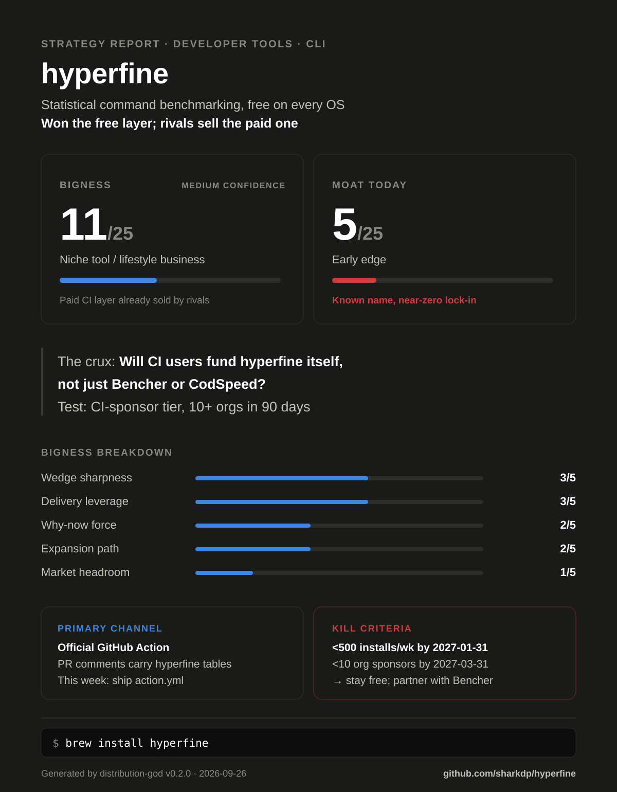

# Strategy Report — hyperfine

<!-- dg: {"v":"0.2.0","rubric":2,"date":"2026-09-26","mode":"sequential","web":true,"bigness":11,"subs":{"market":1,"why_now":2,"wedge":3,"expansion":2,"delivery":3},"confidence":"Medium","moat":5,"moat_rows":{"network":1,"switching":1,"scale_data":0,"brand":2,"cornered_counter":1}} -->

> Generated by distribution-god v0.2.0 on 2026-09-26 (sequential mode; web
> research on). Re-run after major changes; this report includes a delta
> section when a prior report exists.

> **Example run.** An automated analysis of [sharkdp/hyperfine](https://github.com/sharkdp/hyperfine) at commit `f12f3d9` (committed 2026-04-30), run 2026-09-26 by distribution-god v0.2.0 in sequential mode with web research, model claude-opus-5-5, ~11 min. Public information only; not affiliated with or endorsed by the project.

## Verdict

| | |
|---|---|
| **What this is** | A free, cross-platform CLI that benchmarks arbitrary shell commands with statistics (developer tools · Rust CLI binary) |
| **Bigness** | 11/25 — Niche tool / lifestyle business (confidence: Medium) |
| **Moat today** | 5/25 — Early edge: the name is how people refer to shell benchmarking, but nothing stops a user from switching |
| **The crux** | Organizations that run hyperfine in CI will pay the hyperfine project for baselines and PR gating, rather than paying only Bencher or CodSpeed, which already sell that layer |
| **Falsifier** | Add `.github/FUNDING.yml` pointing at the existing Sponsors listing, plus a $100/month "CI sponsor" org tier linked from the README and the Action's PR comment; count org sponsors on the Sponsors dashboard after 90 days (≥10 = true). Cost: ~2 hours + 90 days |

**Bigness breakdown**

| Dimension | Score | Evidence |
|---|---|---|
| Market headroom | 1/5 | SAM ESTIMATE midpoint $138M (section 2), in the $50–200M band |
| Why-now force | 2/5 | AI agents now run measure → change → re-measure loops ([CodSpeed optimize skill](https://github.com/CodSpeedHQ/codspeed/blob/main/skills/codspeed-optimize/SKILL.md), [CodSpeed CLI, 2026-01-23](https://codspeed.io/changelog/2026-01-23-introducing-codspeed-cli)). The mechanism is named, but these are vendor bets, not demand data from this ICP |
| Wedge sharpness | 3/5 | Speed-marketed tools publish hyperfine head-to-heads ([uv BENCHMARKS.md](https://github.com/astral-sh/uv/blob/main/BENCHMARKS.md) wraps hyperfine). Baseline asks: [#607](https://github.com/sharkdp/hyperfine/issues/607) (11 reactions), [#606](https://github.com/sharkdp/hyperfine/issues/606) (6). Requesters not verified as the wedge ICP, so capped at 3 |
| Expansion path | 2/5 | The adjacent CI-history layer is visible, but [Bencher](https://bencher.dev/pricing/) and [CodSpeed](https://codspeed.io/pricing) sell it. hyperfine has no owned path into it (saved runs, #607, still open) |
| Delivery leverage | 3/5 | Near-zero marginal cost (no network deps, `Cargo.toml:19-30`) and ~15 package managers (`README.md:166`). The only repo-attached capture, the sponsor section, was deleted at this commit (`f12f3d9`), and there is no `FUNDING.yml`, so capped at 3 |
| **Total** | **11/25** | |

hyperfine has already won the free layer of its category: 28.9k stars, 721k crates.io downloads, a package in nearly every OS package manager, and the tool uv uses for its public speed claims. The paid layer of the same job (benchmark history and PR gating in CI) is being built by CodSpeed and Bencher, and Bencher already ingests hyperfine's JSON. As a business, hyperfine is a niche tool whose realistic best outcome is being the funded, neutral measurement standard. It is not a SaaS. The one load-bearing caveat: maintainer capacity is falling (227 commits in 2022, 28 in 2025), and every plan below depends on it.

## 1. What the repo says (product intelligence)

- **Scope:** observer run on someone else's repo (sharkdp/hyperfine) at commit `f12f3d9` (committed 2026-04-30). Plans are phrased as what the maintainers would do. Founder fit is inferred from public evidence. GitHub, crates.io and Sponsors counts were fetched on the run date (2026-09-26), after the commit. Not a fork (only `origin` remote).
- **Product:** "A command-line benchmarking tool" (`README.md:6`, `Cargo.toml:4`). It runs statistics across repeated runs, supports warmup, prepare and cleanup hooks, parameter scans and outlier detection, and exports CSV, JSON, Markdown, AsciiDoc and Org (`README.md:15-23`, `src/export/mod.rs:13-17`). It corrects for shell-spawn time (`README.md:98`). Single Rust binary (~4,980 lines in `src/`).
- **ICP & job-to-be-done:** a developer who maintains a CLI, compiler, build tool or package manager and must show "A is faster than B" with numbers they can defend: in a README table, a PR or a paper. The demo is fd vs find (`README.md:8-9`) and the parameter example is `make -j` (`README.md:70`); `CITATION.cff` targets researchers.
- **Stage:** distributed. First commit 2018-01-13; 1,018 commits to `f12f3d9`; 122 author names; v1.20.0 on 2025-11-18 (`CHANGELOG.md:1`, `Cargo.toml:10`). Commits per year: 2022 227, 2023 103, 2024 65, 2025 28, 2026 2 (to 2026-04-30). About one minor release per year since 2022 (`git tag`). 104 `#[test]` functions; CI builds 11 targets (`.github/workflows/CICD.yml:81-92`), a `.deb`, and publishes to winget (`CICD.yml:353`).
- **Strategy signals in code:**
  - License `MIT OR Apache-2.0` (`Cargo.toml:6`). Anyone, including CodSpeed or Bencher, may embed, wrap or fork it; nothing in the license captures value.
  - No auth, billing, multi-tenancy or telemetry: every dependency is local (`Cargo.toml:19-30`). Growth can't be measured from the product, only from registry and release-asset download counts.
  - The integration API is the JSON export (`src/export/json.rs`) plus the Python analysis scripts (`scripts/README.md`). Downstream consumers are Bencher, Chronologer and Venz (`README.md:320-327`).
  - Switching-cost levers point outward. Export is open, and nothing imports prior results (no saved-baseline compare; #607 open).
  - Value capture: the README sponsor slots (Warp, Tuple) were removed in two steps, `327d5f4` (2026-02-14) and `f12f3d9` (2026-04-30, also deleting `doc/sponsors.md`). No `.github/FUNDING.yml`. The maintainer does have a personal GitHub Sponsors listing (59 sponsors, goal "100 monthly sponsors", GitHub GraphQL 2026-09-26), but this repo doesn't link it.
  - Doc drift: `README.md:308` says "Rust 1.76 or newer" but `Cargo.toml:13` requires 1.88.0. `CITATION.cff:16-17` still says 1.16.1 / 2023-03-21.
- **Distribution surface today:** present: crates.io (721,319 all-time and 136,175 recent downloads, crates.io API), GitHub Releases (v1.20.0 assets downloaded 490,088 times vs 331,371 for v1.19.0), ~15 package managers (`README.md:166-305`), GitHub topics `benchmark, cli, command-line, rust, terminal, tool`, man page `doc/hyperfine.1`, shell completions, `CITATION.cff`, a Chinese README link (`README.md:4`), and Markdown export tables people paste into READMEs (`README.md:137`). Absent: a docs site (GitHub homepage field empty), llms.txt, an MCP or agent-skill surface, an official GitHub Action, a Docker image, and any fingerprint in exported tables.

## 2. Market

- **Category:** "command-line benchmarking" for the local tool (the name hyperfine and [bench](https://github.com/Gabriella439/bench) both use). Its paid neighbour is called "continuous benchmarking" ([Bencher](https://bencher.dev/)) or "continuous performance testing" ([CodSpeed](https://codspeed.io/product)). hyperfine sits in the free layer, and the money sits in the continuous layer.
- **Size:** ESTIMATE $43.8M–$438M SAM (geometric midpoint $138M). This is the paid layer the strategy would have to build: hosted baselines and PR gating for command-level benchmarks.
  - Inputs: 36.5M professional developers in early 2025 ([SlashData](https://www.slashdata.co/post/global-developer-population-trends-2025-how-many-developers-are-there)). 1–2% of them work on performance-critical, speed-marketed software that would need command-level CI benchmarking (assumption, unsourced). 6–10 developers per team (assumption). $1,200–$3,600 per team per year, anchored on Bencher Pro at $100/month ([pricing](https://bencher.dev/pricing/)) and CodSpeed Pro at $15/user/month for up to 20 users ([pricing](https://codspeed.io/pricing)).
  - Bottom-up: 36.5M × 1–2% ÷ 6–10 × $1,200–$3,600/yr = $43.8M–$438M
  - Top-down: none found specific to command-level or continuous benchmarking. Broad "performance testing" market figures cover web load testing, a different job, and weren't pulled this run (`unverified`). The bottom-up is the only number, so it is trusted with its assumption flagged.
- **Why now:** (1) AI coding agents now run optimize loops and need a scriptable benchmark with machine-readable output. A vendor ships exactly that loop as an agent skill ([CodSpeed optimize skill](https://github.com/CodSpeedHQ/codspeed/blob/main/skills/codspeed-optimize/SKILL.md)), and CodSpeed launched `codspeed exec` to "benchmark anything" on 2026-01-23 ([changelog](https://codspeed.io/changelog/2026-01-23-introducing-codspeed-cli)). (2) Speed has become the headline claim for new dev tools, and those claims are made with hyperfine ([uv BENCHMARKS.md](https://github.com/astral-sh/uv/blob/main/BENCHMARKS.md)). (3) Low-noise CI runners make wall-time gating viable in CI ([CodSpeed macro runners, 2024-11-27](https://codspeed.io/changelog/2024-11-27-walltime-instrument-and-codspeed-macro-runners); Bencher Bare Metal, [pricing](https://bencher.dev/pricing/)). Forces (1) and (3) favour the paid layer that rivals already sell more than they favour hyperfine.
- **Timing risk:** CodSpeed's free CLI already covers "benchmark any command" with walltime and memory modes ([changelog](https://codspeed.io/changelog/2026-01-23-introducing-codspeed-cli)). Memory is hyperfine's most-requested gap: [#86](https://github.com/sharkdp/hyperfine/issues/86), 96 reactions, open since 2018-09-19. Every quarter without hyperfine 2.0 ([#788](https://github.com/sharkdp/hyperfine/issues/788), planned 2024-12-28) lets that CLI become the default answer instead.
- **Watering holes:** Hacker News (the 2024-11-18 hyperfine thread drew 241 points and 54 comments asking for memory and CPU counters, [HN](https://news.ycombinator.com/item?id=42177462)); the repo's GitHub Discussions (enabled); Bencher's Discord (linked from [pricing](https://bencher.dev/pricing/)); [Terminal Trove](https://terminaltrove.com/hyperfine/); r/rust, This Week in Rust and lobste.rs (unverified, not fetched this run). Queries: "benchmark a shell command", "hyperfine vs poop", "hyperfine GitHub Actions", "hyperfine memory usage" (search volume unverified).

## 3. Competitive field

| Rival | Positioning | Price | Primary channel | Their moat | Their weakness | Source |
|---|---|---|---|---|---|---|
| CodSpeed (`codspeed exec`) | "Continuous Performance Testing for Your CI"; CLI "Benchmark Anything" | Free for OSS and ≤5 users; Pro $15/user/month; Enterprise custom | GitHub Marketplace app plus big-name OSS adoption (lists Astral, Pydantic, Mozilla, TanStack) | Hosted history, simulation mode (<1% variance), 1.33M commits analyzed | Account and dashboard centric; funding small (unverified) | [pricing](https://codspeed.io/pricing), [CLI](https://codspeed.io/changelog/2026-01-23-introducing-codspeed-cli), [Marketplace](https://github.com/marketplace/codspeed-continuous-performance-analysis) |
| Bencher (partner-competitor) | "Continuous Benchmarking"; ingests hyperfine JSON via `shell_hyperfine` | Free for public projects; Pro $100/month (0–250 series); Enterprise custom | Open-source repo plus docs SEO (adapters, prior-art pages) | Adapter breadth, bare-metal runners | 907 GitHub stars (2026-09-26); small reach | [pricing](https://bencher.dev/pricing/), [adapters](https://bencher.dev/docs/explanation/adapters/), [repo](https://github.com/bencherdev/bencher) |
| poop | "Performance Optimizer Observation Platform": peak memory plus 5 hardware counters | Free (open source) | The author's Zig community audience | Hardware counters | Linux-only counters; 2,046 stars | [repo](https://github.com/andrewrk/poop), [comparison #52](https://github.com/andrewrk/poop/issues/52) |
| bench | "Command-line benchmark tool" (hyperfine's inspiration) | Free (open source) | Haskell community | None visible | Slow cadence (last push 2025-09-02); 911 stars | [repo](https://github.com/Gabriella439/bench) |
| github-action-benchmark | "GitHub Action for continuous benchmarking" | Free (open source) | GitHub Marketplace | Default generic CI tracker | Needs a per-language result parser; no hyperfine-native flow found | [repo](https://github.com/benchmark-action/github-action-benchmark) |

Only 5 direct rivals found. [blacha/hyperfine-action](https://github.com/blacha/hyperfine-action) (20 stars) is a complement, not a rival.

**Indirect:** `time` and `perf stat` (already installed, good enough for one-off checks; named in [HN](https://news.ycombinator.com/item?id=42177462)); in-language microbenchmark harnesses such as [criterion.rs](https://github.com/bheisler/criterion.rs) (5,528 stars), which win whenever the thing measured is a function rather than a process; do nothing (most speed claims ship without any benchmark at all, unverified).

**Cautionary tale:** none found this run. Bencher's [prior-art list](https://bencher.dev/docs/reference/prior-art/) is mostly single-project dashboards (Codespeed forks, rustc-perf), which suggests most teams build their own history layer rather than buy one. That is a warning for any paid-layer plan.

**White space:** the neutral, account-free standard for **head-to-head comparisons against rival tools**, published in READMEs and PRs. CodSpeed and Bencher track your own commits over time. Nobody owns "us vs them, reproducible, on every OS", and hyperfine's multi-command relative-speed table (`README.md:137-143`) and 11 release targets already back it.

## 4. Strategy

- **Positioning:** For maintainers of speed-marketed developer tools, hyperfine is the only command-line benchmarking tool that turns "we're 10× faster than X" into a reproducible, statistically corrected table on any OS without an account, because it corrects for shell spawn (`README.md:98`), detects outliers (`src/outlier_detection.rs`), exports JSON and Markdown the ecosystem already reads, and ships for 11 targets (`CICD.yml:81-92`).
- **Wedge:** maintainers who publish head-to-head speed comparisons against rival tools and want them re-run on every release in CI (uv-style BENCHMARKS.md). 6-month win condition: an official Action that posts the comparison table on PRs, adopted by 100 public repos, including the maintainer's own fd and bat.
- **Expansion:** head-to-head comparisons in CI → saved baselines and base-vs-head gating (#607, #606) → multi-metric (memory, #86) for the agent-optimization loop → funded neutral standard that paid layers (Bencher, CodSpeed) integrate with and sponsor. Each step reuses the same CLI and JSON. None requires a hosted service.

## 5. Distribution plan

**Channel ranking** (rubric /20):

| Channel | Reach | Econ | Repo evidence | Founder fit | Total | Call |
|---|---|---|---|---|---|---|
| Official GitHub Action (Marketplace) posting PR comparison tables | 4 | 5 | 2 | 4 | 15/20 | PRIMARY |
| Agent skill (Agent Skills standard for Claude Code and Codex) + llms.txt | 3 | 5 | 3 | 3 | 14/20 | secondary |
| OS package managers + crates.io | 1 | 5 | 5 | 5 | 16/20 | claimed |
| GitHub README / repo SEO | 1 | 5 | 4 | 4 | 14/20 | claimed |
| Show HN for hyperfine 2.0 | 3 | 5 | 2 | 4 | 14/20 | ignition |
| Partner co-listing (Bencher / CodSpeed integration pages) | 3 | 4 | 4 | 3 | 14/20 | defer |
| Docs site + comparison pages (GEO) | 3 | 5 | 1 | 2 | 11/20 | defer |
| Hosted history SaaS + outbound | 2 | 1 | 0 | 1 | 4/20 | defer |

The Action wins because its results test the crux directly: do teams want hyperfine in CI enough to adopt it, and later to fund it? Each PR comment is also an artifact that every contributor to that repo sees.

**Founder-fit basis:** inferred from public evidence. One dominant maintainer (David Peter, ~607 of 1,018 commits under two names). He built bat (60.6k stars) and fd (44.5k) and has 8,250 GitHub followers; his profile lists company @openai. He runs a deep release pipeline (`CICD.yml`) but commit cadence is falling (28 in 2025).

**Deferred channels:** hosted SaaS and outbound (no auth or billing in the repo, one part-time maintainer, and two funded rivals already sell it). Docs site and GEO pages (no docs site exists; wait until 2.0 gives comparison pages something new to say). Partner co-listing (worth more after the Action proves CI demand, so the ask carries numbers). One primary channel only. Spreading across four channels before traction is how this plan would fail.

**Sequence:**
- **First 10:** repos, not users. The maintainer adds the Action to fd, bat and hexyl himself. Then he opens PRs adding it to 7 repos that already publish hyperfine tables: uv (its `scripts/benchmark`), plus the ones found by searching GitHub for `hyperfine --export-markdown`.
- **First 100:** Show HN for the 2.0 release that ships the Action and saved baselines, a This Week in Rust item, and an answer in every open issue asking for CI usage (#607, #606).
- **First 1,000:** the Marketplace listing tuned as a landing page (first line: "Benchmark your tool against rivals on every PR"). A "Benchmarked with hyperfine" link in each PR comment. The agent skill, so agents that are asked "is this faster?" reach for the same Action. Growth is read weekly from the dedicated asset's download count.

**90-day plan:**
- Week 1: ship a composite `action.yml` that installs from a dedicated release asset and posts `--export-markdown` output as a PR comment → Action → dedicated-asset downloads.
- Week 2–4: add FUNDING.yml and a CI-sponsor tier (→ crux → org sponsors); fix the README Rust-version and CITATION drift (→ registries → failed `cargo install` reports); land the saved-baseline slice of #607 (→ Action → repos using gating mode); publish the agent skill and llms.txt (→ secondary → skill installs).
- Month 2: add the Action to the first 10 repos; Marketplace listing copy; answer #606 and #607 with the Action → repos using the Action.
- Month 3: hyperfine 2.0 with interleaved runs (#21) and peak memory (Unix first, #86); Show HN → stars, asset downloads, sponsors.
- **Week-12 checkpoint:** ≥100 repos using the Action and ≥500 dedicated-asset downloads/week means double down. Fewer than 10 org sponsors means stop the paid-layer idea and take the partner path.

## 6. Gaps

| Gap | Severity | Blocks channel | Fix | Effort |
|---|---|---|---|---|
| No official Action / Marketplace listing (only a third-party one with 20 stars) | P0 | GitHub Action | Composite `action.yml` in the repo, installing from a dedicated release asset | S |
| No saved-baseline or base-vs-head compare (#607 open) | P0 | GitHub Action | Load a prior `--export-json` as the reference and report the delta ([#788](https://github.com/sharkdp/hyperfine/issues/788), item 3) | M |
| Sequential runs are noisy on shared CI runners (interleaving #21 open, 25 reactions) | P0 | GitHub Action | Interleave base and head runs within one job; gate on relative speed, not absolute times | M |
| No repo-attached value capture (sponsor slots removed `f12f3d9`; no FUNDING.yml) | P1 | Action (maintenance funding) | `.github/FUNDING.yml` → existing Sponsors listing; org "CI sponsor" tier | S |
| Wall time only; memory is the top request (#86, 96 reactions) and a rival's headline feature | P1 | Agent skill, Show HN | Peak RSS from `wait4`/`getrusage` on Unix first; multi-metric JSON in 2.0 | L |
| No measurement surface (no telemetry, `Cargo.toml:19-30`) | P1 | Action | Dedicated release asset for Action installs; read `download_count` weekly | S |
| Bus factor 1; commits falling | P1 | All | Name 1–2 co-maintainers with merge rights for the Action and scripts | M |
| `README.md:308` says Rust 1.76; `Cargo.toml:13` needs 1.88 | P2 | Registries (`cargo install`) | Update the README line | S |
| `CITATION.cff:16-17` stale (1.16.1, 2023) | P2 | Research citations | Bump to 1.20.0 on each release | S |
| No llms.txt, docs site or homepage field | P2 | Agent skill / GEO | llms.txt with install, the five core invocations and JSON schema | S |
| Markdown export carries no fingerprint | P2 | Action PR comments | Add "Benchmarked with hyperfine vX" in the Action's comment, not in the CLI output | S |

## 7. Moat roadmap

**Moat today**

| Row | Score | Evidence |
|---|---|---|
| Network economies | 1/5 | Users interact through issues and the JSON format (Bencher, Chronologer, Venz consume it, `README.md:320-327`), but the product doesn't improve with user count |
| Switching costs | 1/5 | Wrapper scripts and habits (uv's `scripts/benchmark`) are lost; the exported JSON is open and Bencher already ingests it, so history moves in minutes |
| Scale economies / data | 0/5 | No telemetry, no usage data (`Cargo.toml:19-30`) |
| Brand / category ownership | 2/5 | Named in comparisons ([poop #52](https://github.com/andrewrk/poop/issues/52), [Bencher prior art](https://bencher.dev/docs/reference/prior-art/), [uv](https://github.com/astral-sh/uv/blob/main/BENCHMARKS.md)); 28.9k stars vs 2.0k (poop) and 0.9k (bench). AI-assistant answers unverified, so anchor 3 is not fully met |
| Cornered resource / counter-positioning | 1/5 | Soft exclusive: the maintainer's reputation (bat, fd) and third-party packaging in ~15 package managers built over 8 years |
| **Total** | **5/25** | Early edge |

Nothing here stops a determined rival. The most reachable moat is the brand one, and it is probably under-scored only because it is unmeasured.

- **Buildable powers:** (1) **Brand / category ownership.** Become the default answer, verified, for "benchmark a command" in AI assistants and on PRs: the Action's comment fingerprint plus the agent skill. (2) **Counter-positioning.** Free, local, no account, 11 targets. CodSpeed's funnel is its dashboard, so a permanently account-free head-to-head CLI is costly for it to match. Whether `codspeed exec` needs an account locally is unverified.
- **Compounding loop:** `more PR comments showing hyperfine tables → more contributors and agents meet hyperfine → more repos add the Action → more PR comments`
- **First signal:** weekly downloads of the Action's dedicated release asset. Check at week 6 (≥100/week) and week 12 (≥500/week). Also run a monthly share-of-answer check: ask ChatGPT, Claude and Gemini "how do I benchmark a command-line program?" and log whether hyperfine is named first.
- **Incumbent response:** CodSpeed ships a free head-to-head mode for `codspeed exec` with a hyperfine-JSON importer and markets memory mode against #86. The loop survives only if hyperfine closes the memory gap and stays the neutral format everyone ingests. If CodSpeed's free CLI matches it on every OS, hyperfine's edge shrinks to "already installed via apt/brew".

## 8. What would have to be true (top-band outcome)

1. At least 5% of professional developer teams pay for command-level continuous benchmarking (this report assumes 1–2%).
2. Organizations pay the hyperfine project at least $1,200/yr directly (sponsor tier or hosted history), and don't pay only Bencher or CodSpeed.
3. A funded steward exists: at least one maintainer commit-week per week, sustained for 6 months.
4. hyperfine 2.0 ships multi-metric support (memory at minimum) across platforms before CodSpeed's CLI becomes the default answer.
5. AI coding agents choose hyperfine by default for speed checks, visible as release-asset downloads growing ≥50% year over year.

## 9. Kill criteria

- If the Action's dedicated asset is below 500 downloads/week by 2027-01-31, stop investing in the CI channel. Keep hyperfine a free local tool and point CI users to Bencher's `shell_hyperfine` adapter.
- If fewer than 10 org sponsors pay ≥$100/month by 2027-03-31, drop any paid-layer plan and take the partner path (a sponsorship or referral deal with Bencher or CodSpeed).
- If saved-baseline compare (#607) isn't merged by 2027-03-31, ship the Action as comment-only (no gating) and stop promoting it for regression checks.

## 10. Next 5 actions (this week)

1. Maintainers: add a composite `action.yml` that installs hyperfine from a dedicated release asset and posts the `--export-markdown` table as a PR comment. Serves the PRIMARY Action channel; moves dedicated-asset downloads.
2. Maintainers: add `.github/FUNDING.yml` pointing at the existing Sponsors listing, plus a $100/month "CI sponsor" org tier linked from the README. Tests the crux; moves the org-sponsor count.
3. Maintainers: open the design PR for #607 (load a prior JSON as the reference) as the first shipped slice of #788. Unblocks the Action's gating mode; moves repos using gating.
4. Maintainers: publish an agent skill (SKILL.md: when to use hyperfine, `-N` for fast commands, `--export-json`) and a repo `llms.txt`. Serves the secondary channel; moves skill installs and share-of-answer.
5. Maintainers: fix `README.md:308` (Rust 1.88) and bump `CITATION.cff` to 1.20.0. Protects the claimed registry channel; moves failed-install issues to zero.

## Dissent

**Red-team adjustments:** Bigness 11→11, Moat 7→5

- Serious, applied: Brand / category ownership 4 → 2. The only evidence was naming in comparisons; AI-assistant answers were unverified (memory is not a source), so anchor 3 isn't fully met (section 7).
- Serious, applied: the wedge was partly owned. CodSpeed lists Astral (uv's maker) among its clients ([pricing](https://codspeed.io/pricing)), so the wedge is narrowed to head-to-head comparisons against rivals, which regression trackers don't target (section 4).
- Serious, applied: wall-clock timing on shared CI runners is noisy, which is why rivals built bare-metal and simulation runners. Added interleaving (#21) as a P0 gap and made the Action gate on relative speed within one job (sections 5 and 6).
- Serious, applied: the moat loop's "more JSON history → switching costs" step feeds rivals, because Bencher ingests the JSON. Buildable powers changed to brand plus counter-positioning (section 7).
- Serious, applied: a weaker hidden assumption is maintainer capacity (sponsor slots removed, profile lists @openai, 28 commits in 2025). Added to kill criteria and "what would have to be true"; the falsifier now uses the existing Sponsors listing (sections 8 and 9).
- Serious, partly rebutted: CodSpeed could bundle head-to-head and memory into `codspeed exec` within 90 days. Rebutted in part by counter-positioning (an account-free CLI conflicts with CodSpeed's dashboard funnel). Applied in part: memory is kept as the P1 defense.
- Minor, rebutted: Delivery leverage might escape the cap because a Sponsors listing exists (59 sponsors). The listing is the maintainer's portfolio-wide one and this repo doesn't link it, so it isn't capture attached to this product. Adding FUNDING.yml is what would earn 4.
- Minor, rebutted: Expansion could read as 3, because CI history is reachable through Bencher's adapter. That path belongs to a rival, not to hyperfine, and #607 is open. It does not cross a band either way.

## Sources

- **Repo evidence (commit `f12f3d9`):** `README.md`, `Cargo.toml`, `CHANGELOG.md`, `CITATION.cff`, `.github/workflows/CICD.yml`, `src/`, `git log` / `git shortlog`. GitHub API (2026-09-26): stars 28,907, forks 510, topics, releases; issue reactions via `search/issues?sort=reactions`; Sponsors listing via GraphQL. crates.io API (2026-09-26): 721,319 downloads, 136,175 recent.
- **Market:** [SlashData developer population 2025](https://www.slashdata.co/post/global-developer-population-trends-2025-how-many-developers-are-there) · [Bencher pricing](https://bencher.dev/pricing/) · [CodSpeed pricing](https://codspeed.io/pricing) · [HN thread 2024-11-18](https://news.ycombinator.com/item?id=42177462) · [Terminal Trove](https://terminaltrove.com/hyperfine/)
- **Rivals:** [CodSpeed CLI changelog](https://codspeed.io/changelog/2026-01-23-introducing-codspeed-cli) · [CodSpeed Marketplace](https://github.com/marketplace/codspeed-continuous-performance-analysis) · [Bencher adapters](https://bencher.dev/docs/explanation/adapters/) · [Bencher prior art](https://bencher.dev/docs/reference/prior-art/) · [poop](https://github.com/andrewrk/poop) · [poop #52](https://github.com/andrewrk/poop/issues/52) · [bench](https://github.com/Gabriella439/bench) · [github-action-benchmark](https://github.com/benchmark-action/github-action-benchmark) · [blacha/hyperfine-action](https://github.com/blacha/hyperfine-action) · [criterion.rs](https://github.com/bheisler/criterion.rs)
- **Trends:** [CodSpeed optimize skill](https://github.com/CodSpeedHQ/codspeed/blob/main/skills/codspeed-optimize/SKILL.md) · [CodSpeed macro runners](https://codspeed.io/changelog/2024-11-27-walltime-instrument-and-codspeed-macro-runners) · [uv BENCHMARKS.md](https://github.com/astral-sh/uv/blob/main/BENCHMARKS.md) · [hyperfine #788 (2.0 plan)](https://github.com/sharkdp/hyperfine/issues/788) · [#86](https://github.com/sharkdp/hyperfine/issues/86)
- **Research limits:** the session's WebSearch budget ran out after 10 searches in this run, so later checks used direct page fetches and the GitHub API. CodSpeed funding, r/rust / This Week in Rust / lobste.rs presence, and AI-assistant answers are `unverified`.
