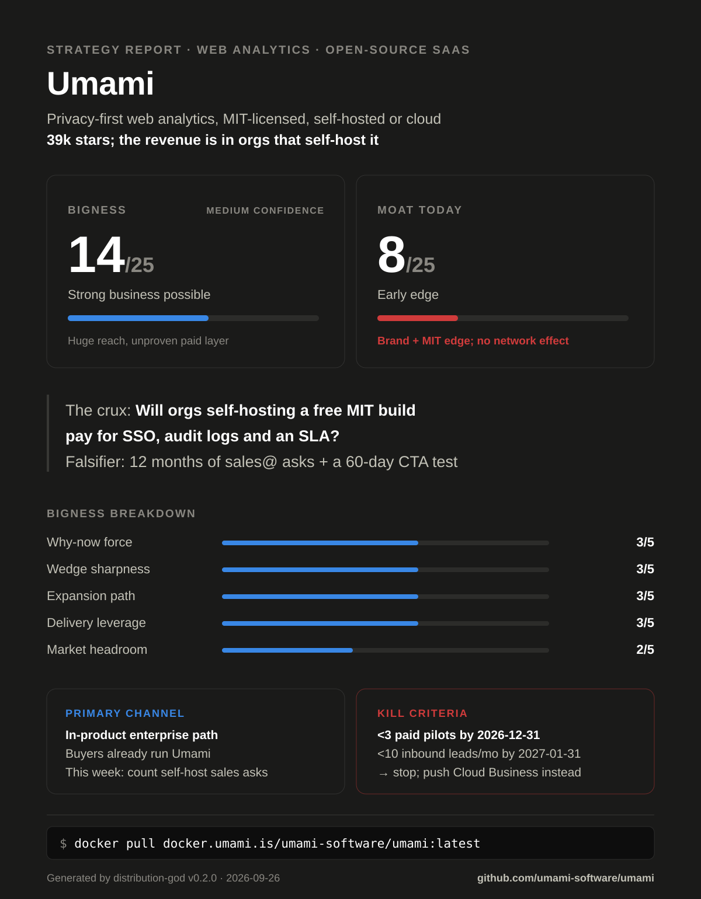

# Strategy Report — Umami

<!-- dg: {"v":"0.2.0","rubric":2,"date":"2026-09-26","mode":"sequential","web":true,"bigness":14,"subs":{"market":2,"why_now":3,"wedge":3,"expansion":3,"delivery":3},"confidence":"Medium","moat":8,"moat_rows":{"network":1,"switching":2,"scale_data":1,"brand":2,"cornered_counter":2}} -->

> Generated by distribution-god v0.2.0 on 2026-09-26 (sequential mode; web
> research on). Re-run after major changes; this report includes a delta
> section when a prior report exists.

> **Example run.** An automated analysis of [umami-software/umami](https://github.com/umami-software/umami) at commit `ec0ff50` (committed 2026-09-16), run 2026-09-26 by distribution-god v0.2.0 in sequential mode with web research, model claude-opus-5-5, ~18 min. Public information only; not affiliated with or endorsed by the project.

## Verdict

| | |
|---|---|
| **What this is** | Privacy-first, cookieless web and product analytics: MIT-licensed, self-hosted (Docker + Postgres/ClickHouse) or hosted as Umami Cloud SaaS |
| **Bigness** | 14/25 — Strong business possible (confidence: Medium) |
| **Moat today** | 8/25 — Early edge: category-leading GitHub brand and a license edge over AGPL rivals, but no network effect and history can be exported |
| **The crux** | Organizations that already self-host the free, fully featured MIT build will pay for a compliance layer (SSO/SCIM, audit log, support SLA) |
| **Falsifier** | (1) Count the last 12 months of sales@umami.is threads plus #3163 commenters from company domains asking for SSO/support on self-hosted (1 hour). (2) Ship a static admin-only Settings → Enterprise page with a ref-tagged link and count qualified inquiries and signed pilots at $5k+/yr over 60 days (1 week of build) |

**Bigness breakdown**

| Dimension | Score | Evidence |
|---|---|---|
| Market headroom | 2/5 | SAM ESTIMATE $45.6M–$2.05B, geometric midpoint ~$306M falls in the $200–500M band (section 2); top-down cross-check lands in the same band |
| Why-now force | 3/5 | EU–US Data Privacy Framework undercut by *Trump v. Slaughter*; noyb asks for withdrawal and plans an annulment suit ([noyb, 29 Jun 2026](https://noyb.eu/en/us-supreme-court-just-blew-eu-us-data-transfers)). Self-hosting keeps data on EU servers. One force: the consent-signal push is the same EU-privacy wave |
| Wedge sharpness | 3/5 | Identifiable ICP (EU orgs already running self-hosted Umami) with an ongoing compliance job. [#3163](https://github.com/umami-software/umami/issues/3163) OIDC request has 161 reactions, but its authors are mostly home-lab self-hosters, not the paying segment, so the cap holds at 3 |
| Expansion path | 3/5 | The same orgs' product teams can use funnels, retention, replays and revenue already in the build (`src/app/api/websites/[websiteId]/`). Non-EU enterprises go to Cloud Enterprise (SAML SSO listed on [pricing](https://umami.is/pricing)) |
| Delivery leverage | 3/5 | Standard SaaS: Cloud charges per event with overage ($0.00003/event Pro, [pricing](https://umami.is/pricing)), so serving is not near-zero cost, and the enterprise wedge adds support labor. Paid capture exists (`src/lib/subscription.ts:25`) |
| **Total** | **14/25** | |

Umami already won open-source distribution: at 39k stars it is the most-starred
privacy analytics repo. But its MIT license means the free build, hosting
resellers and AI-built clones all compete with its own Cloud. The business
the evidence supports is selling compliance to the European organizations
that already self-host it, now that the EU–US data deal is shaky again. That
makes a strong small-team company, and venture scale only if product
analytics becomes a real second act.

## 1. What the repo says (product intelligence)

- **Scope:** Someone else's repo, so observer mode: every action is what Umami
  Software's maintainers would do, and founder fit comes from public evidence.
  Monorepo: the root Next.js app is analyzed, and `packages/api-client` and
  `packages/mcp` count as its surfaces. Analyzed at commit `ec0ff50`
  (2026-09-16, tag v3.4.0).
- **Product:** "a privacy-first analytics platform. Traffic, campaigns,
  behavior, conversions, and revenue in one place — no cookies … self-hosted
  or in the cloud" (`README.md:8`, `package.json:4`). It's a Next.js 16 app on
  PostgreSQL (`README.md:30-31`), with optional ClickHouse
  (`src/lib/clickhouse.ts:38`) and Kafka (`src/lib/kafka.ts:3`) for scale.
  Reports go well past pageviews: funnels, goals, journeys, retention,
  attribution, revenue, heatmaps, Core Web Vitals and UTM
  (`src/app/(main)/websites/[websiteId]/(reports)/`), plus session replays
  via rrweb (`package.json:127`) and links/pixels products
  (`src/app/(main)/links/`, `src/app/(main)/pixels/`).
- **ICP & job-to-be-done:** a developer or platform engineer who runs sites for
  a company, agency or project and wants to see traffic, sources and
  conversions without a cookie banner or shipping visitor data to Google. The
  README speaks only to self-hosters (install from source, Docker).
- **Stage:** distributed. The repo has 6,855 commits since 2020-07-17,
  1,510 in the last 12 months and 286 in the last 3. Releases are frequent:
  v3.0.0 on 2025-11-06, then v3.1.0 (2026-04-16), v3.2.0 (2026-06-24),
  v3.3.0 (2026-08-11) and v3.4.0 (2026-09-16). About 100 people committed in
  the last 12 months, but two founders (Mike Cao, Francis Cao) wrote ~82%
  (1,234 of 1,510, `git shortlog`), so bus factor ≈2. Tests: 24 API spec files
  (`tests/api/`), 39 unit-test files in `src/lib/`, and CI (`.github/workflows/ci.yml`).
  There's no CHANGELOG file; notes live in GitHub releases.
- **Strategy signals in code:**
  - **License:** MIT (`LICENSE:1`). Anyone may host, resell or white-label it,
    and PikaPods and Elestio already do (section 3). The maintainers say they
    have "never gated major features behind Umami Cloud"
    ([2025 review](https://umami.is/blog/year-in-review-2025)).
  - **Paid layer:** Cloud-only plan limits sit behind `CLOUD_MODE`: 1 website on
    free, 20 on Pro, 10 teams on Pro (`src/lib/subscription.ts:25-29`), enforced
    at `src/app/api/websites/route.ts:39-51`. Cloud images build from separate
    branches (`.github/workflows/cd-cloud.yml:3-7`). The repo has no Stripe
    code; billing lives in the private Cloud code.
  - **Auth:** local users, 2FA (`README.md:53-55`) and API keys. There's no
    OIDC/SAML/LDAP (grep finds none). `/sso` is only a bearer-token handoff
    (`src/app/sso/SSOPage.tsx:13-30`). OIDC is the most-reacted open issue
    ([#3163](https://github.com/umami-software/umami/issues/3163), 161
    reactions). A maintainer said it would come after v3.
  - **Telemetry:** anonymous build ping (version, OS, Docker/CI) to
    `api.umami.is/v1/telemetry` (`scripts/telemetry.js:9-25`, off with
    `DISABLE_TELEMETRY`, `scripts/postbuild.js:5`), an admin-UI pixel
    (`src/app/api/scripts/telemetry/route.ts:4-8`), and a version check
    (`src/lib/constants.ts:19-20`). So maintainers can count instances, but
    can't see activation or who the org is.
  - **Platform surface:** OpenAPI-generated typed client (`package.json:46-50`),
    a read-only MCP server (`packages/mcp/package.json:3`, v0.2.0; self-hosted
    is off by default, `README.md:57`), and a Cloud-only streaming API.
  - **Switching levers:** CSV/zip export (`src/app/api/websites/[websiteId]/export/route.ts:1-2`).
    Custom events are instrumented in customer code (`umami.track`,
    `src/tracker/index.ts:99-123`). There's no importer from GA or rivals in
    the repo. Cloud imports are done by hand from Umami/CSV only
    ([docs](https://docs.umami.is/docs/cloud/import-data.md)).
  - **Ecosystems ridden:** Next.js/Vercel, Prisma/Postgres, ClickHouse, and the
    self-hosting ecosystem (Docker, Podman, Coolify).
- **Distribution surface today:**
  - **Present:** GitHub (39,014 stars, 8,124 forks, 9 topics including
    `google-analytics`, via the GitHub API on 2026-09-26). Docker images on
    GHCR and `docker.umami.is` (`README.md:91`). Docker Hub
    `umamisoftware/umami` shows 175,000 pulls, a partial count.
  - **Present (registries and docs):** npm `@umami/node` (17,814/mo),
    `@umami/api-client` (13,067/mo) and `@umami/mcp` (341/mo). Hosted MCP at
    `cloud.umami.is/mcp`. `docs.umami.is/llms.txt` has 296 lines. The site has
    13 comparison pages and 13 persona pages (umami.is sitemap).
  - **Present (one-click deploys):** Heroku, Vercel, Netlify and Podman configs (`app.json`, `vercel.json`, `netlify.toml`, `podman/`), awesome-selfhosted, Coolify.
  - **Absent:** `umami.is/llms.txt` (404), and a README feature overview,
    screenshot or comparison (the README is install-only). No self-hosted
    admin UI or doc points to a paid or enterprise path (grep finds no
    `enterprise` or `sales@` in `src/`).

## 2. Market

- **Category:** privacy-first web analytics. Buyers and roundups call it a
  "Google Analytics alternative"
  ([Databuddy roundup](https://www.databuddy.cc/blog/7-privacy-first-google-analytics-alternatives-you-need-to-know-in-2026)).
  The name is contested, because Umami now also markets against product
  analytics (Mixpanel, PostHog, Amplitude, Heap:
  [umami.is/compare](https://umami.is/compare)). This report sizes the
  web-analytics layer and treats product analytics as expansion.
- **Size:** ESTIMATE $45.6M–$2.05B SAM (geometric midpoint ~$306M)
  - Bottom-up: W3Techs surveys "well over 20 million" relevant sites, and 43%
    of them run no traffic-analysis tool, so 57% do
    ([methodology](https://w3techs.com/technologies),
    [survey 2026-09-26](https://w3techs.com/technologies/overview/traffic_analysis)).
    Assumption: 5–15% of those are privacy-constrained (EU/UK GDPR or
    privacy-positioned) and need a hosted or team layer, at 1–3 sites per
    paying org and $240–$1,200 per org per year. $240 is Umami Pro at $20/mo;
    $1,200 is a Pro/Business blend, with Business at $200/mo
    ([pricing](https://umami.is/pricing), read from the page's embedded plan
    data because it renders client-side).
    `20M × 57% × 5–15% × $240–$1,200 ÷ 1–3 = $45.6M–$2.05B`.
  - Top-down: Mordor Intelligence puts the whole web analytics market at
    ESTIMATE $7.98B in 2025 and $9.19B in 2026
    ([Mordor](https://www.mordorintelligence.com/industry-reports/web-analytics-market)).
    Assumption: 3–10% is the privacy-first, self-serve slice:
    `$7.98B × 3–10% = $239M–$798M` (midpoint ~$437M). The two midpoints are
    within 3× and in the same band. Bottom-up sets the headline because its
    inputs can be observed. The privacy-share assumption decides the band on
    its own: 3–10% instead of 5–15% would drop the bottom-up midpoint to
    ~$193M, which is band 1 (ESTIMATE).
- **Why now:**
  - The EU–US Data Privacy Framework is wobbling again. The US Supreme Court's
    *Trump v. Slaughter* (June 2026) ended FTC independence, which the
    framework relies on. noyb asked the Commission to withdraw adequacy and
    announced a CJEU annulment suit
    ([noyb, 29 Jun 2026](https://noyb.eu/en/us-supreme-court-just-blew-eu-us-data-transfers);
    [Wikipedia](https://en.wikipedia.org/wiki/EU%E2%80%93US_Data_Privacy_Framework)).
    The Data Protection Review Court was already unable to rule after the
    January 2025 firings. The mechanism: EU organizations using US-processed
    analytics face transfer risk again, and self-hosting on EU servers
    sidesteps it.
  - Consent friction is being re-legislated. A 19-organization coalition backs
    binding browser privacy signals in the Digital Omnibus (Art. 88b GDPR
    proposal)
    ([noyb, 10 Sep 2026](https://noyb.eu/en/open-letter-civil-society-coalition-urges-eu-kill-cookie-banner)).
    If one-click refusal becomes the default, consent-based tools lose more
    visitors while no-consent tools keep full counts. That mechanism is my
    inference, and it's contested.
  - AI assistants are becoming the analytics interface. Umami shipped a
    read-only MCP server (Cloud now, self-hosted opt-in,
    [announcement](https://umami.is/blog/introducing-umami-mcp)), so an
    assistant can query the data directly and the incumbent's dashboard stops
    being the lock-in. Adoption is `unverified`.
- **Timing risk:**
  - The 2022 EU rulings against Google Analytics barely moved the market. GA
    still runs on 47.3% of sites, against Matomo 1.4%, Plausible 0.2% and
    Umami under 0.1%
    ([W3Techs](https://w3techs.com/technologies/overview/traffic_analysis)).
    A CJEU annulment takes 2–3 years (noyb, above).
  - Umami Software is a San Francisco company
    ([2022 release](https://www.globenewswire.com/news-release/2022/07/19/2481786/0/en/Umami-Raises-1-5-Million-Pre-Seed-Funding-Round-Led-by-Race-Capital-to-Continue-Growing-its-Popular-Open-Source-Privacy-Focused-Web-Analytics-Platform.html)),
    and most of its Cloud subprocessors are US
    ([subprocessors](https://umami.is/subprocessors)). So the DPF tailwind
    helps EU-made rivals and self-hosting, not Umami Cloud.
  - AI coding agents can build a personal Umami Cloud replacement "in one
    session" ([canivibecodeit, verified 2026-08-07](https://canivibecodeit.com/umami-cloud)).
- **Watering holes:**
  - r/selfhosted and the [awesome-selfhosted list](https://github.com/awesome-selfhosted/awesome-selfhosted)
    (Umami listed).
  - Coolify one-click templates
    ([umami.yaml](https://github.com/coollabsio/coolify/blob/main/templates/compose/umami.yaml))
    and the PikaPods and Elestio catalogs.
  - Umami's Discord (1,637 members, Discord invite API on 2026-09-26) and the
    #3163 thread.
  - Queries: "google analytics alternative", "self-hosted analytics", "umami
    vs plausible", "matomo alternative", "GDPR analytics without cookie
    banner".
  - Hacker News is a weak channel here: no Umami story from 2024–2026 scored
    above 4 points ([HN search](https://hn.algolia.com/?q=umami%20analytics)).

## 3. Competitive field

| Rival | Positioning | Price | Primary channel | Their moat | Their weakness | Source |
|---|---|---|---|---|---|---|
| Plausible | "Simple, privacy-friendly Google Analytics alternative" | Starter $9/mo (10k pageviews), Business $19/mo | Content + OSS; "never spent a cent on advertising" | Brand in the EU privacy niche; 21,000+ paying subscribers, self-funded, team of 10 | AGPL-3.0 rules it out where AGPL is banned; SSO only on Enterprise | [about](https://plausible.io/about), [pricing](https://plausible.io/#pricing), [GitHub 29,219★](https://github.com/plausible/analytics) |
| Matomo | "100% data ownership and full privacy compliance" | Cloud from €29/mo (50k hits); On-Premise free; SAML SSO is a paid plugin (price `unverified`) | Installed base + public sector | Largest self-hosted footprint (1.4% of sites) | GPL PHP stack; features sold as a paid-plugin patchwork | [pricing](https://matomo.org/pricing/), [LoginSaml](https://plugins.matomo.org/LoginSaml), [W3Techs](https://w3techs.com/technologies/overview/traffic_analysis) |
| Fathom | "A simple, privacy-friendly Google Analytics alternative" | $15/mo for 100k pageviews, 50 sites | SEO/content | "Used by thousands of companies" | Closed source, no self-hosting | [pricing](https://usefathom.com/pricing) |
| Rybbit | "open-source and privacy-friendly alternative to Google Analytics that is 10x more intuitive" | Standard $13/mo, Pro $26/mo (billed annually) | GitHub momentum: 13,067★ since 2025-01-14 | Velocity | AGPL-3.0; young | [pricing](https://www.rybbit.com/pricing), [GitHub](https://github.com/rybbit-io/rybbit) |
| PostHog | "Privacy-focused web analytics", cookies optional, inside a product suite | 1M analytics events/mo free | PLG + developer content | Breadth (replay, flags, warehouse) | Web analytics is a side product; mixed license (NOASSERTION) | [web analytics](https://posthog.com/web-analytics), [pricing](https://posthog.com/pricing) |
| Simple Analytics | "Simple, privacy-friendly analytics" | Free (1-month history); from $20/mo | EU privacy content | EU company | Closed source, narrow feature set | [pricing](https://www.simpleanalytics.com/pricing) |
| OpenPanel | "open-source alternative to Mixpanel with optional self-hosting" | `unverified` | OSS GitHub (7,054★) | none yet | AGPL-3.0 | [GitHub](https://github.com/Openpanel-dev/openpanel) |

**Indirect:**
- **Google Analytics:** free, on 47.3% of sites, and wired into Google Ads,
  so it wins by default.
- **Cloudflare Web Analytics:** free, cookieless, bundled with the CDN; 2.1% of sites
  ([Cloudflare](https://www.cloudflare.com/web-analytics/)).
- **Do nothing:** 43% of sites run no analytics tool.
- **Hosted clones of Umami itself:** PikaPods from $2.8/mo
  ([catalog](https://www.pikapods.com/apps)) and Elestio from $11/mo
  ([Elestio](https://elest.io/open-source/umami)). They sell the hosting layer
  that Umami Cloud sells.

**Cautionary tale:** no category deaths found within the search budget. The
live lesson is Umami's own: an MIT license maximizes adoption and invites
third parties to sell the hosting layer. PikaPods and Elestio already do.

**White space:** nobody claims "self-hosted analytics that passes your security
review." Matomo holds EU self-hosting on a GPL PHP stack with paid plugins,
and Plausible, Rybbit and OpenPanel are AGPL. Google bans AGPL outright ("MUST
NOT be used at Google",
[policy](https://opensource.google/documentation/reference/using/agpl-policy)).
That leaves open a permissive-license, modern-stack product with SSO, audit
and support, and Umami's MIT build plus product-grade features can back it.

## 4. Strategy

- **Positioning:** For platform teams at European organizations that must keep
  visitor data on their own servers, Umami is the only MIT-licensed analytics
  platform in this field that ships funnels, retention, session replays,
  revenue and an MCP endpoint in the free build. Evidence: the full report
  set is in the open build (`src/app/api/websites/[websiteId]/`,
  `packages/mcp/`), it runs from one compose file (`docker-compose.yml:4`),
  and it needs no cookies (`README.md:8`). The paid layer is compliance, not
  features.
- **Wedge:** EU organizations of about 200–5,000 staff (universities, public
  bodies, publishers, SaaS companies) that already run self-hosted Umami and
  now need it to pass a security review. That means SSO, an audit log, a
  support SLA and a supported ClickHouse path. The six-month win condition is
  10 signed Umami Enterprise contracts at $5k+/yr each (a proposed floor),
  all from the existing self-hosted base.
- **Expansion:** EU self-hosted enterprise leads to the same orgs' product
  teams (replacing Mixpanel/Amplitude seats with funnels, retention and
  replays already in the build). That in turn leads to non-EU enterprises on
  Cloud Enterprise (SAML, SLA, invoice billing already listed) and then to
  agencies on Business white-label. Each enterprise win adds a reference that
  shortens the next security review.

## 5. Distribution plan

**Channel ranking** (rubric /20):

| Channel | Reach | Econ | Repo evidence | Founder fit | Total | Call |
|---|---|---|---|---|---|---|
| In-product enterprise path for self-host admins (static Settings → Enterprise page, release notes, docs) | 4 | 4 | 3 | 4 | 15/20 | PRIMARY |
| Comparison SEO + GEO on wedge queries ("Umami vs Matomo On-Premise", "self-hosted analytics SSO") | 2 | 5 | 4 | 4 | 15/20 | secondary |
| Open-source reach (GitHub, awesome-selfhosted, Discord) | 2 | 5 | 5 | 5 | 17/20 | claimed |
| Hosting templates and resellers (Coolify, PikaPods, Elestio, Heroku/Vercel/Netlify) | 2 | 3 | 5 | 3 | 13/20 | claimed |
| Launch of free OIDC + Enterprise line (GitHub release, r/selfhosted, Discord) | 3 | 5 | 3 | 3 | 14/20 | ignition |
| Agent-installability program (MCP registries, coding-agent defaults) | 1 | 5 | 4 | 4 | 14/20 | defer |
| Founder-led cold outbound to crawled self-hosted domains | 3 | 4 | 2 | 2 | 11/20 | defer |
| Paid search (a Google Ads tag is already on umami.is) | 2 | 1 | 2 | 3 | 8/20 | defer |

The primary and secondary tie at 15. The in-product path is primary because its
results test the crux directly: do self-hosters pay?

**Founder-fit basis:** inferred from public evidence. There are three founder
brothers (Mike, Brian and Francis Cao, per the 2022 funding release). Two of
them wrote ~82% of commits in the last 12 months, which shows engineering
strength. The marketing site shows content capacity (26 comparison and
persona pages) and uses Google Ads. No public sales hire was found
(`unverified`), so outbound scores 2.

**Deferred channels:**
- **Agent-installability as a program:** the surfaces already exist, but the
  wedge buyer doesn't pick vendors through coding agents. Registry listings
  are a one-hour task, not a program.
- **Cold outbound at scale:** founder fit for sales is unproven. Trackers can
  be renamed (`TRACKER_SCRIPT_NAME`, `next.config.ts:23`), so crawls
  undercount. Cold email also collides with the privacy brand.
- **Paid search:** a $240/yr Pro plan can't pay for search CAC, and running
  a Google Ads tag contradicts the "no surveillance" claim.

**Sequence:**
- **First 10:** email by hand every organization that already wrote to
  `sales@umami.is` about self-hosting, or commented on #3163 from a company
  domain. Offer design-partner pricing for OIDC plus a support SLA, and run
  founder calls.
- **First 100:** the ignition event is the free-OIDC release plus an
  "Umami Enterprise" announcement in the GitHub release notes, r/selfhosted
  and Discord. The unscalable motion is founder-run onboarding and hands-on
  ClickHouse migration for every lead.
- **First 1,000:** 1,000 paying organizations that arrived via the self-host
  path. Every release carries the Enterprise path in its notes, and the metric
  is enterprise inquiries per 1,000 active instances (the version-check count).

**90-day plan:**
- **Week 1:** count 12 months of self-host SSO/support asks → primary →
  qualified orgs (the crux baseline).
- **Week 2:** ship a static, admin-only Settings → Enterprise page and a docs
  page. It makes no network call and works under `PRIVATE_MODE`, and it
  carries a ref-tagged link → primary → inquiries per week.
- **Week 3:** commit on #3163 that OIDC ships free, and publish the paid line
  (SAML/SCIM, audit log, LTS, SLA) → primary → design-partner sign-ups.
- **Week 4:** publish the Matomo On-Premise comparison and a post-DPF
  self-hosting guide. Add `umami.is/llms.txt` and remove the Ads tag →
  secondary → page visits and assistant citations.
- **Month 2:** ship OIDC plus the first SAML/audit-log build to design
  partners, and hold 10 calls a week → primary → signed pilots.
- **Month 3:** put the Enterprise path in every release note, spec a GA4
  import, and publish two design-partner case studies → primary and
  secondary → inquiries and win rate.
- **Week-12 checkpoint:** 30+ qualified conversations and 3+ signed at $5k+/yr means double down.
  Fewer than 10 conversations means the self-host base doesn't hold the buyer: move to Cloud Business self-serve.

## 6. Gaps

| Gap | Severity | Blocks channel | Fix | Effort |
|---|---|---|---|---|
| No OIDC/SAML/LDAP in the self-hosted build; `/sso` is only a token handoff (`src/app/sso/SSOPage.tsx:13-30`) | P0 | In-product enterprise path | Ship OIDC free (the better-auth SSO plugin the maintainer named in #3163); SAML/SCIM and audit log in the Enterprise build | L |
| No enterprise path anywhere in the self-hosted product or docs. The only in-app surface, `UpdateNotice`, is hidden under `PRIVATE_MODE`/`DISABLE_UPDATES` (`src/app/(main)/UpdateNotice.tsx:15-22`) | P0 | In-product enterprise path | Static admin-only Settings → Enterprise page, docs page, README line, release-note footer | S |
| No self-hosted enterprise offer or price anchor; Enterprise is Cloud-only "Custom" ([pricing](https://umami.is/pricing)) | P1 | In-product enterprise path (scale) | Publish the self-hosted Enterprise package with a starting price | S |
| Postgres slows at scale ([#4526](https://github.com/umami-software/umami/issues/4526)); ClickHouse is supported but has no supported migration path | P1 | Enterprise retention | Reference ClickHouse deployment and migration runbook, sold with support | M |
| No importer from GA4 or rivals; Cloud import is manual, from Umami/CSV only | P1 | Comparison SEO/GEO (switchers) | GA4 BigQuery-export importer in the open build | M |
| Cloud subprocessors are mostly US ([list](https://umami.is/subprocessors)), which is a weak story for EU buyers after the DPF ruling | P1 | Expansion to Cloud Enterprise | EU-only processing option with a published transfer impact assessment | L |
| Marketing site loads a Google Ads tag (`AW-11312352810` on umami.is/pricing) | P2 | Comparison SEO/GEO (credibility) | Remove it, or measure conversions with Umami itself | S |
| `umami.is/llms.txt` returns 404 (docs subdomain has one) | P2 | Comparison SEO/GEO | Root llms.txt linking docs, comparisons, pricing | S |
| README is install-only: no feature list, screenshot or comparison, on a 39k-star page | P2 | Comparison SEO/GEO | Feature table and demo GIF above the fold | S |

## 7. Moat roadmap

**Moat today**

| Row | Score | Evidence |
|---|---|---|
| Network economies | 1/5 | Teams and share links (`src/app/share/`) connect users, but one customer's value doesn't grow with others' |
| Switching costs | 2/5 | Years of history, saved boards and funnels, and custom events coded into apps (`src/tracker/index.ts:99-123`) are lost on exit. CSV/zip export exists, so days-long migration (anchor 3) is unproven |
| Scale economies / data | 1/5 | Install telemetry is collected (`scripts/telemetry.js:15-25`) but doesn't improve the product; no rival-proof unit-cost edge is shown |
| Brand / category ownership | 2/5 | Most-starred in the category (39,014 vs Plausible 29,219, Matomo 21,900). Named in privacy roundups but missing from a mainstream GA-alternatives roundup ([Leadfeeder](https://www.leadfeeder.com/blog/comparisons/google-analytics-alternatives/)). Assistant answers not verified |
| Cornered resource / counter-positioning | 2/5 | MIT passes procurement where AGPL rivals don't ([Google policy](https://opensource.google/documentation/reference/using/agpl-policy)), and those rivals can't relicense without inviting the clones Umami already faces. Not 3: Matomo (GPL) and Cloudflare aren't shut out |
| **Total** | **8/25** | Early edge |

- **Buildable powers:**
  - **Switching costs:** SSO/SCIM wired into the identity provider, audit
    logs feeding compliance, and custom events plus revenue instrumented in
    product code. Each makes leaving a multi-team project.
  - **Brand:** become the default answer to "self-hosted analytics"
    for security-reviewed orgs, in comparisons and assistant answers.
- **Compounding loop:** `more orgs self-host Umami → more of them hit a security review → Enterprise contracts fund SSO, ClickHouse scale and support → Umami passes more reviews and earns references → more orgs choose it to self-host`.
  It's honest to say this loop compounds brand and switching costs, not a
  network effect.
- **First signal:** enterprise inquiries per 1,000 active self-hosted instances
  per month. Check at day 45; zero means the loop doesn't start.
- **Incumbent response:** Matomo is the most dangerous rival. It could bundle
  SAML, support and an Umami importer into an EU public-sector package within
  90 days. The loop survives only because the wedge is Umami's own installed
  base, where switching means re-instrumenting events. It does not survive if
  Umami delays OIDC and lets #3163 fester.

## 8. What would have to be true (top-band outcome)

1. The CJEU annuls, or the Commission withdraws, the EU–US DPF by the end of
   2028, and at least one EU DPA issues a new transfer decision against a US
   analytics tool.
2. At least 200 organizations pay $10k+/yr for Umami Enterprise (self-hosted
   or dedicated) by the end of 2028, with no community fork passing 10% of
   Umami's stars.
3. Umami wins 30%+ of tracked head-to-head product-analytics deals against
   PostHog or Mixpanel inside existing customers.
4. Umami Cloud net revenue retention stays above 110% (Pro → Business →
   Enterprise).
5. Umami is cited in most monthly answers from the major AI assistants to
   "best self-hosted analytics".

## 9. Kill criteria

- If fewer than 3 enterprise contracts at $5k+/yr are signed by 2026-12-31,
  stop the paid self-hosted build and redirect to Cloud Business conversion.
- If the in-product path yields fewer than 10 qualified inquiries a month by
  2027-01-31 (after three releases carry it), remove it and treat the
  self-host base as reach only.
- If fewer than 10 paying Enterprise organizations exist by 2027-03-31, drop
  the EU-enterprise wedge and re-run this analysis with agencies (Business
  white-label) as the wedge.

## 10. Next 5 actions (this week)

1. Count 12 months of `sales@umami.is` threads and #3163 comments from company domains that ask for SSO or support on self-hosted — serves the in-product enterprise path — moves "qualified orgs" (the crux baseline).
2. Ship a static, admin-only Settings → Enterprise page plus a docs page with a ref-tagged link, making no network call — serves the in-product enterprise path — moves inquiries per week.
3. Commit on #3163 that OIDC ships free in the MIT build and name the paid line (SAML/SCIM, audit log, LTS, SLA) — serves the in-product enterprise path — moves design-partner sign-ups.
4. Publish "Umami vs Matomo On-Premise" and add `umami.is/llms.txt` — serves comparison SEO/GEO — moves comparison-page visits and assistant citations.
5. Remove the Google Ads tag from umami.is — serves comparison SEO/GEO — removes the easiest rival attack on the "no surveillance" claim.

## Dissent

**Red-team adjustments:** Bigness 14→14, Moat 7→8.

- **Applied, serious.** The primary channel relied on `UpdateNotice`, which is
  hidden under `PRIVATE_MODE`/`DISABLE_UPDATES` (`UpdateNotice.tsx:18-19`),
  the settings locked-down wedge orgs are most likely to use. The channel is
  now a static Settings page plus docs and release notes (sections 5 and 6).
- **Applied, serious.** The crux had a cheaper falsifier: the existing
  `sales@umami.is` inbox needs no build. It is now step 1 of the Falsifier
  and action 1.
- **Applied, serious.** The moat loop was a funding loop. It is rewritten
  around switching costs and brand, and says plainly that no network effect
  exists (section 7).
- **Rebutted, serious.** "Matomo already owns the wedge" (1.4% of sites,
  paid SAML plugin). The wedge is Umami's own installed base, which already
  chose Umami, and switching means re-instrumenting events. Matomo's paid
  SSO plugin is evidence that self-hosters pay for SSO, which supports the
  crux. Matomo is now named in the positioning and gaps.
- **Rebutted, serious.** "Why-now is fragile" (it hurts Umami Cloud, and the
  2022 rulings didn't change adoption). Anchor 3 requires one sourced
  tailwind that directly enables the product. The wedge is self-hosted, which
  is exactly what the DPF collapse favors, and the source is primary (noyb,
  29 Jun 2026). The counter-case is in Timing risk, and confidence stays
  Medium.
- **Rebutted, serious (band boundary).** Market headroom 2 depends on the
  privacy-share input. The top-down cross-check ($7.98B × 3–10%, midpoint
  ~$437M) lands in band 2 independently.
- **Score flag applied.** Cornered resource / counter-positioning 1 → 2: the
  MIT license is a procurement edge over AGPL rivals that they can't copy
  without inviting hosted clones.
- **Score flag, boundary.** Bigness 14 is one point above the 8–13 band.
  Why-now and Market headroom are each one point from flipping the verdict
  to "Niche tool / lifestyle business". Both were rebutted above, and this is
  the main reason confidence is Medium, not High.
- **Applied, minor.** Gating SAML/SCIM conflicts with the "never gated major
  features" stance, so OIDC ships free and only compliance features are paid.
- **Overruled, minor.** Switching costs 2 → 3 (custom events coded into
  apps). I kept the lower anchor because there's no evidence of what share of
  accounts instrument events.

## Sources

Research limits: the session's WebSearch budget ran out after 3 searches, so the rest came from direct fetches of primary pages plus the GitHub (4 calls), npm, Docker Hub and HN Algolia APIs. umami.is renders client-side, so plans and prices come from the pricing page's embedded JS payload (2026-09-26). BuiltWith was blocked, and two analyst URLs returned unrelated reports; neither is used.

**Market:** W3Techs [survey](https://w3techs.com/technologies/overview/traffic_analysis) and [methodology](https://w3techs.com/technologies) · [Mordor web analytics](https://www.mordorintelligence.com/industry-reports/web-analytics-market) · Umami [pricing](https://umami.is/pricing), [Cloud](https://docs.umami.is/docs/cloud.md), [subscription](https://docs.umami.is/docs/cloud/subscription.md), [import](https://docs.umami.is/docs/cloud/import-data.md), [subprocessors](https://umami.is/subprocessors), [2025 review](https://umami.is/blog/year-in-review-2025), [MCP post](https://umami.is/blog/introducing-umami-mcp) · [2022 pre-seed release](https://www.globenewswire.com/news-release/2022/07/19/2481786/0/en/Umami-Raises-1-5-Million-Pre-Seed-Funding-Round-Led-by-Race-Capital-to-Continue-Growing-its-Popular-Open-Source-Privacy-Focused-Web-Analytics-Platform.html)

**Rivals:** Plausible [about](https://plausible.io/about), [pricing](https://plausible.io/#pricing) · Matomo [pricing](https://matomo.org/pricing/), [LoginSaml](https://plugins.matomo.org/LoginSaml) · [Fathom](https://usefathom.com/pricing) · [Rybbit](https://www.rybbit.com/pricing) · PostHog [web analytics](https://posthog.com/web-analytics), [pricing](https://posthog.com/pricing) · [Simple Analytics](https://www.simpleanalytics.com/pricing) · [Cloudflare](https://www.cloudflare.com/web-analytics/) · [PikaPods](https://www.pikapods.com/apps) · [Elestio](https://elest.io/open-source/umami) · GitHub API stars and licenses for plausible/analytics, matomo-org/matomo, rybbit-io/rybbit, PostHog/posthog, Openpanel-dev/openpanel (2026-09-26) · roundups: [Databuddy](https://www.databuddy.cc/blog/7-privacy-first-google-analytics-alternatives-you-need-to-know-in-2026), [Leadfeeder](https://www.leadfeeder.com/blog/comparisons/google-analytics-alternatives/), [canivibecodeit](https://canivibecodeit.com/umami-cloud), [awesome-selfhosted](https://github.com/awesome-selfhosted/awesome-selfhosted)

**Trends:** noyb [Supreme Court and DPF, 29 Jun 2026](https://noyb.eu/en/us-supreme-court-just-blew-eu-us-data-transfers) and [cookie-banner letter, 10 Sep 2026](https://noyb.eu/en/open-letter-civil-society-coalition-urges-eu-kill-cookie-banner) · [Wikipedia: EU–US DPF](https://en.wikipedia.org/wiki/EU%E2%80%93US_Data_Privacy_Framework) · [Google AGPL policy](https://opensource.google/documentation/reference/using/agpl-policy) · repo issues [#3163](https://github.com/umami-software/umami/issues/3163) and [#4526](https://github.com/umami-software/umami/issues/4526)
