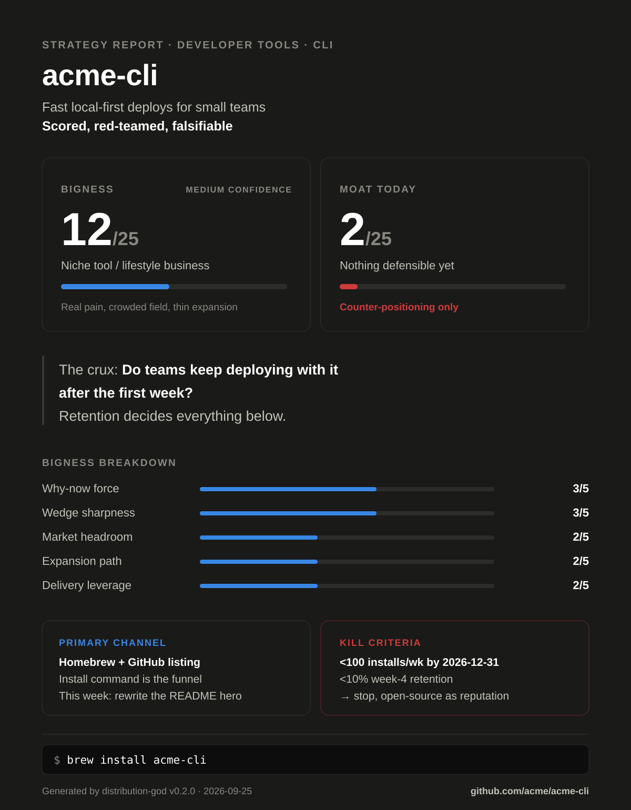

# Strategy Report — acme-cli

<!-- dg: {"v":"0.4.0","rubric":2,"date":"2026-09-25","mode":"sequential","web":true,"bigness":12,"subs":{"market":2,"why_now":3,"wedge":3,"expansion":2,"delivery":2},"confidence":"Medium","moat":2,"moat_rows":{"network":0,"switching":1,"scale_data":0,"brand":0,"cornered_counter":1}} -->

> Generated by distribution-god v0.4.0 on 2026-09-25 (sequential mode; web
> research on). SYNTHETIC TEST FIXTURE — a fictional product used by
> `tests/run.sh` to prove `check_report.py` accepts a valid report.

## Verdict

| | |
|---|---|
| **What this is** | Local-first deploy CLI for small teams |
| **Bigness** | 12/25 — Niche tool / lifestyle business (confidence: Medium) |
| **Moat today** | 2/25 — Nothing defensible yet: counter-positioning only |
| **The crux** | Do teams keep deploying with it after week one? |
| **Falsifier** | Week-4 retention of the first 50 installs via opt-in ping; free, 30 days |

**Bigness breakdown**

| Dimension | Score | Evidence |
|---|---|---|
| Market headroom | 2/5 | SAM geometric midpoint $240M (section 2) |
| Why-now force | 3/5 | Platform shift to edge runtimes ([source](https://example.com/edge)) |
| Wedge sharpness | 3/5 | README targets 2–10 person teams (`README.md:3`); no external users yet (cap 3) |
| Expansion path | 2/5 | Team tier possible but not reachable from the CLI today |
| Delivery leverage | 2/5 | Self-serve, but manual onboarding documented (`docs/setup.md:1`) |
| **Total** | **12/25** | |

A real pain in a crowded field. Keep it small and profitable unless retention
proves the crux.

**Path to the next band:** Bigness 12 → 14 (Strong business possible) needs +2 · Moat 2 → 5 (Early edge) needs +3

| # | Move | Raises | Now → next | The next point needs | Kind | Effort |
|---|---|---|---|---|---|---|
| 1 | Replace the manual setup doc with one `acme init` command | Delivery leverage | 2 → 3 | "Standard SaaS/library economics" — install to first deploy with no human step | outcome | S |
| 2 | Get 3 Rust edge teams outside the author's network deploying weekly | Wedge sharpness | 3 → 4 | "requests or threads from at least 3 different people or orgs" — their issues or posts, linked | outcome | M |
| 3 | Publish the offline-deploy benchmark in This Week in Rust | Brand / category ownership | 0 → 1 | "Recognized in one niche community" — the newsletter item, linked | outcome | S |
| 4 | Open GitHub Discussions | Network economies | 0 → 1 | "Users interact, but value doesn't grow with count" — threads, but no user gains from another | rubric-only | S |

**Locked by caps:** Wedge sharpness stays at 3 until people in the wedge other than the author use it; Delivery leverage can't pass 3 without value capture that exists today (no billing code).

## 1. What the repo says (product intelligence)

- **Product:** a deploy CLI (`src/main.rs:1`)
- **ICP & job-to-be-done:** a 2–10 person team shipping a web app weekly
- **Stage:** usable — 40 commits in 90 days, one contributor
- **Strategy signals in code:** MIT license; no telemetry; no billing code
- **Distribution surface today:** Homebrew formula present; no llms.txt

## 2. Market

- **Category:** developer deploy tooling
- **Size:** ESTIMATE $120M–$480M SAM (geometric midpoint $240M): 400k teams × $300–1,200/yr = $120M–$480M
- **Why now:** edge runtimes make local-first deploys viable
  ([source](https://example.com/edge))
- **Timing risk:** hosting platforms bundle one-command deploys

## 3. Competitive field

| Rival | Positioning | Price | Primary channel | Their moat | Their weakness | Source |
|---|---|---|---|---|---|---|
| ExampleDeploy | Deploys for everyone | $20/mo | SEO | Brand | Slow builds | [site](https://example.com/rival) |

**Indirect:** shell scripts — free and already written.

**White space:** local-first deploys with no hosted control plane.

## 4. Strategy

- **Positioning:** For small teams, acme-cli is the only deploy tool that
  works fully offline, because it has no server component (`src/main.rs:1`).
- **Wedge:** Rust teams on edge runtimes; win 50 weekly-active teams in 6 months.
- **Expansion:** Rust teams → all edge teams → team audit log.

## 5. Distribution plan

**Channel ranking** (rubric /20):

| Channel | Reach | Econ | Repo evidence | Founder fit | Total | Call |
|---|---|---|---|---|---|---|
| Homebrew + GitHub listing | 4 | 5 | 4 | 3 | 16/20 | PRIMARY |
| Technical content | 3 | 4 | 2 | 3 | 12/20 | secondary |
| Paid ads | 2 | 1 | 1 | 3 | 7/20 | defer |

**Founder-fit basis:** assumed 3/5 for every channel — no team info given.

**Deferred channels:** paid ads — CAC exceeds a $300/yr price.

**Sequence:**
- **First 10:** DM ten Rust edge-runtime maintainers
- **First 100:** Show HN with a 60-second demo
- **First 1,000:** weekly release notes plus the Homebrew listing

**90-day plan:**
- Week 1: README hero rewrite → Homebrew listing → install rate
- Week 2–4: demo GIF → Show HN → stars
- Month 2: two benchmarks → content → referral installs
- Month 3: retention review → all → week-4 retention
- **Week-12 checkpoint:** 100 weekly installs and 10% week-4 retention

## 6. Gaps

| Gap | Severity | Blocks channel | Fix | Effort |
|---|---|---|---|---|
| No retention measurement | P0 | Homebrew + GitHub listing | Opt-in anonymous ping | S |

## 7. Moat roadmap

**Moat today**

| Row | Score | Evidence |
|---|---|---|
| Network economies | 0/5 | None |
| Switching costs | 1/5 | Config files take minutes to recreate |
| Scale economies / data | 0/5 | None |
| Brand / category ownership | 0/5 | Unknown outside the author's network |
| Cornered resource / counter-positioning | 1/5 | Offline-first is awkward for hosted rivals |
| **Total** | **2/25** | Nothing defensible yet |

- **Buildable powers:** brand, via the benchmark everyone cites
- **Compounding loop:** `more benchmarks → more citations → more installs → more benchmarks`
- **First signal:** referral installs from benchmark pages, checked monthly
- **Incumbent response:** a host ships an offline mode; the loop may not survive

## 8. What would have to be true (top-band outcome)

1. Week-4 retention of at least 25%
2. Teams pay for an audit log

## 9. Kill criteria

- If weekly installs < 100 by 2026-12-31, stop and open-source as reputation.

## 10. Next 5 actions (this week)

1. Rewrite the README hero — serves Homebrew listing — install rate
2. Record a 60-second demo — serves Show HN — stars
3. Add the opt-in ping — serves measurement — week-4 retention
4. DM ten maintainers — serves first 10 — activations
5. Publish one benchmark — serves content — referral installs

## Dissent

**Red-team adjustments:** Bigness 13→12, Moat 2→2.

Serious objection applied: Expansion path cut 3→2 — the team tier needs a
server the product doesn't have.

## Sources

- Market: [edge runtimes](https://example.com/edge)
- Rivals: [ExampleDeploy](https://example.com/rival)
